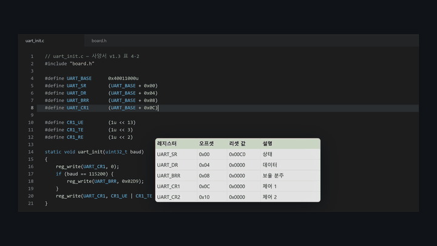
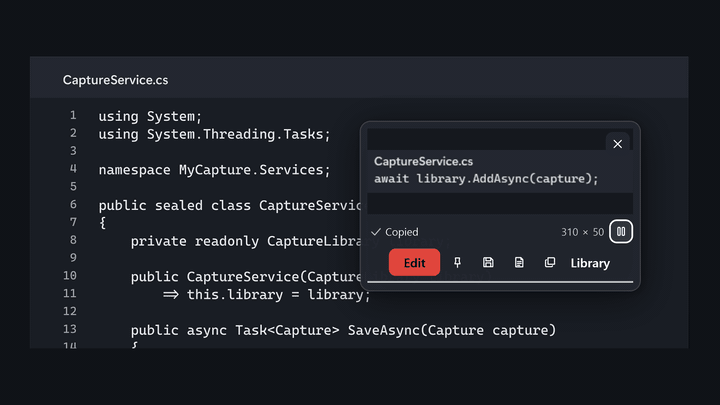

# MyCapture

엑셀 사양 표와 자주 쓰는 코드를 에디터 위에 띄워 두고, 보면서 코딩하다가 원문 그대로 붙여 넣는 Windows 핀 도구입니다.

광고·계정 없이 무료이고 회사 업무에도 씁니다. 캡처와 글자 인식은 이 PC 안에서 처리하며, 소스 코드는 이 저장소에 MIT 라이선스로 공개되어 있습니다. Windows 11과 Windows 10 버전 22H2(x64)에서 실행하며, ARM64 PC에서는 Windows 11이 필요합니다. 소개 페이지는 <https://mimiloaf.com/mycapture/>입니다.

새 버전이 있으면 앱에서 알려 줍니다. Store와 GitHub 설치형은 **업데이트**로 설치하고, 포터블은 릴리스 페이지에서 새 ZIP을 받습니다. 자동 확인은 **설정 > 정보 > 새 버전 자동 확인**에서 끌 수 있습니다. 배포 형식별 동작과 연결 주소는 [업데이트 안내](docs/install.md#업데이트)에 있습니다.

## 기본 캡처 도구와 다른 점

**엑셀 표와 코드를 원문째 띄우는 핀.** 엑셀에서 범위를 복사해 핀으로 띄우면 엑셀이 클립보드에 함께 넣는 그림을 그대로 보여 주므로 글꼴·채우기·테두리가 시트에서 보던 모양 그대로입니다. 셀 값은 탭 구분 원문으로 핀에 붙어 있습니다. 색 정보를 함께 복사하는 에디터에서 복사한 코드는 에디터 색과 들여쓰기를 유지한 코드 핀이 되고, 그 밖의 텍스트는 글자 그대로 그린 핀이 됩니다. 엑셀이나 에디터에서 `Ctrl+C`를 누른 뒤 `F3`을 누르면 복사한 내용이 핀으로 뜨고, 에디터의 입력 위치는 그대로 남습니다. 핀에서 `Ctrl+C`나 `Ctrl+더블클릭`을 누르면 원문을 그대로 복사하므로 에디터나 시트에 바로 붙여 넣습니다.

**코드를 덮지 않는 핀 조작.** 핀 위에서 `Ctrl+휠`을 굴리면 투명도가 20–100%로 바뀌고, 오른쪽 클릭 메뉴의 '뒤 창 클릭 허용'을 켜면 핀이 떠 있는 자리에서도 아래 창을 클릭해 입력합니다. 휠로 10–800% 확대·축소합니다. `Shift+F3`으로 핀을 모두 숨기거나 다시 보이고, 앱을 다시 실행하면 열려 있던 핀이 다시 뜹니다. 최근 닫은 핀은 20개까지 위치·배율·투명도 그대로 다시 엽니다. 핀은 작업 표시줄과 `Alt+Tab` 목록에 나타나지 않습니다.

**이미지 속 글자 복사.** 데이터시트나 웹 문서를 캡처한 이미지 핀도 `Ctrl+더블클릭`하면 이 PC에서 한국어·영어 글자를 인식해 복사합니다. `Ctrl+Shift+C`로 캡처하면 캡처가 클립보드에 복사되므로, 이어서 `F3`을 누르면 그 캡처가 핀이 됩니다. 이미지 속 표는 CSV·Markdown·탭 구분 형식으로 복사합니다.

**창 제목과 글자로 찾는 라이브러리.** 캡처할 때 창 제목을 함께 저장하고, 이미지 속 글자는 이 PC에서 인식해 둡니다. 파일 이름이나 오류 메시지의 한 구절로 캡처를 찾을 수 있고, 녹화한 MP4도 같은 라이브러리에서 재생합니다.

**공유 전 주석과 개인정보 가리기.** 이슈에 붙일 화면에는 편집기에서 화살표·텍스트·단계 번호를 넣고 블러나 모자이크로 일부를 가립니다. `Ctrl+Shift+R`을 누르면 화면 속 이메일 주소, 카드번호, IP 주소, 한국 전화번호와 주민등록번호 형태의 숫자, GitHub 토큰·AWS 액세스 키·`sk-`로 시작하는 API 키를 찾아 가림막을 씌웁니다. 가림막은 저장하기 전에 옮기거나 지울 수 있습니다.

## 핀 조작

| 핀에서 | 동작 |
|---|---|
| `Ctrl+C`, `Ctrl+더블클릭` | 원문 복사. 이미지 핀은 `Ctrl+더블클릭`으로 이 PC에서 인식한 글자를 복사 |
| `Ctrl+휠` | 투명도 20–100% |
| 휠 | 확대·축소 10–800% |
| 드래그 | 이동 |
| 오른쪽 클릭 | 뒤 창 클릭 허용, 원문 텍스트 복사, 닫은 핀 다시 열기, 저장, 모두 닫기 |
| `Esc` | 닫기 |

뒤 창 클릭을 허용한 핀은 클릭을 받지 않으므로 `Shift+F3`을 두 번 누르거나 트레이 메뉴의 '모든 핀 클릭 허용 해제'로 되돌립니다.

## 기본 단축키

| 동작 | 새 설치 기본값 | 비고 |
|---|---|---|
| 클립보드 이미지·텍스트·표를 핀으로 띄우기 | `F3` | 4.5.0부터 새 설치 기본값. 트레이 메뉴의 '클립보드를 핀으로 띄우기'로도 실행. PNG 투명도와 텍스트/표 원문을 보존. GitHub 첨부 URL을 만든 뒤에는 추출한 GitHub 이미지 URL을 핀으로 띄움 |
| 영역 캡처 | `Ctrl+Shift+C` | 캡처는 클립보드에 복사되므로 이어서 `F3`을 누르면 핀이 됩니다. 캡처 직후 뜨는 작은 카드에서는 클릭하거나 `Alt+Q`를 누른 뒤 `E` 편집, `S` 저장, `T` 텍스트 복사 |
| 핀 모두 숨기기/보이기 | `Shift+F3` | 4.5.0부터 새 설치 기본값. 트레이 메뉴의 '핀 모두 숨기기'로도 실행 |
| 영역 녹화 시작/중지 | `Ctrl+Shift+X` | 같은 키로 녹화 종료 |
| 라이브러리 열기 | 설정에서 지정(예: `Ctrl+Shift+Z`) | 이미지와 동영상을 함께 조회하고 동영상을 창 안에서 재생 |
| 클립보드 이미지를 GitHub 첨부 URL로 | 설정에서 지정(예: `F9`) | 설정한 이슈 Write 칸에 붙여 넣고 user-attachments URL을 복사 |
| 편집기 개인정보 가리기 | `Ctrl+Shift+R` | 편집기 안에서. 이 PC에서 인식한 개인정보 후보를 편집 가능한 가림막으로 추가 |
| 편집기 빠른 저장 | `Ctrl+S` | 편집기 안에서. PNG 저장 후 편집된 이미지를 클립보드에 복사 |
| 편집기 다른 이름으로 저장 | `Ctrl+Shift+S` | 편집기 안에서. PNG 저장 후 편집된 이미지를 클립보드에 복사 |
| 핀 이미지 빠른 저장 | `Ctrl+S` | 핀에 포커스가 있을 때 원본 PNG 저장 |
| 핀 이미지 다른 이름으로 저장 | `Ctrl+Shift+S` | 오른쪽 클릭 메뉴에서도 실행 가능 |

새로 설치하면 영역 캡처 `Ctrl+Shift+C`, 영역 녹화 `Ctrl+Shift+X`, 클립보드 핀 `F3`, 핀 모두 숨기기 `Shift+F3`이 정해져 있습니다. 다른 프로그램이 이미 쓰는 키는 실행할 때 알려 주므로 설정에서 다른 키로 바꾸십시오. `Ctrl+Shift+Z`는 여러 편집기의 다시 실행 키라서 라이브러리 열기와 GitHub 첨부는 필요한 사람이 설정에서 지정합니다. 이전 버전부터 쓰던 설정은 저장된 키를 그대로 유지합니다.

단축키는 설정에서 바꿀 수 있습니다. 그 밖의 전역 단축키, 창 제목 기록, 빠른 저장 파일명 규칙은 [기능과 화면](docs/features.md#기본-단축키)에 정리했습니다.

## 문서

- [사용법 가이드](docs/guides/README.md): 기능별 사용법과 녹화 → GIF 내보내기
- [기능과 화면](docs/features.md): 전체 기능 목록과 화면
- [설치와 배포](docs/install.md): Store 설치본과 GitHub 릴리스의 설치 파일·포터블 ZIP, `SHA256SUMS.txt` 확인, 설치 로그와 종료 코드, 사용자 데이터 위치, 개인정보와 네트워크
- [소스에서 빌드](docs/build.md): .NET 10 SDK 준비, 빌드와 테스트, 자체 진단(self-test)
- [4.6.0 릴리스 노트](docs/releases/4.6.0-release-notes.md)와 [이전 릴리스 노트](docs/releases/)
- [지원](https://github.com/sukwoo0711-maker/mycapture-support)과 [개인정보처리방침](https://mimiloaf.com/mycapture/privacy/)
- [소개 페이지](https://mimiloaf.com/mycapture/)와 게시자 [Mimiloaf](https://mimiloaf.com/). 메일 문의는 [support@mimiloaf.com](mailto:support@mimiloaf.com)으로 보내 주십시오.

보안 문제는 공개 이슈에 재현 자료를 올리지 말고 [`SECURITY.md`](SECURITY.md)의 비공개 신고 절차를 따르십시오. 개발 참여 방법은 [`CONTRIBUTING.md`](CONTRIBUTING.md)를 참고하십시오.

## 라이선스

MyCapture 자체 코드에는 [MIT License](LICENSE)가 적용됩니다. 배포 패키지에 포함되는 .NET/WPF 런타임과 기타 구성요소는 각각의 라이선스를 따르며, 자세한 출처와 배포 고지는 [`THIRD-PARTY-NOTICES.md`](THIRD-PARTY-NOTICES.md)에서 확인할 수 있습니다.

---

## English

A Windows pinning tool that keeps your Excel spec table and go-to code snippets above the editor, so you can code while you look and paste the original text back.

Free, including for work, with no ads and no account. Capture and text recognition run on this PC, and the source code is in this repository under the MIT License. MyCapture runs on Windows 11 and Windows 10 version 22H2 (x64); ARM64 PCs need Windows 11. Website: <https://mimiloaf.com/en/mycapture/>

The app automatically checks for new versions and shows an update notice. **Update** installs the new version for Store and GitHub setup installs; portable copies open the release page for a new ZIP. Turn off automatic checks in **Settings > About > Check for new versions automatically**. See [update behavior and network destinations](docs/install.md#english-summary).

### What it adds to Snipping Tool

**Pins that keep Excel tables and code as text.** Copy a range in Excel and pin it: the pin shows the picture Excel puts on the clipboard, so fonts, fills and borders look the way they do in the sheet, and the cell values stay attached as tab-separated text. Code copied from an editor that includes colors becomes a code pin with the editor's colors and indentation; other text is drawn as plain text. Press `Ctrl+C` in Excel or your editor, then `F3`, and what you copied becomes a pin while your cursor stays in the editor. `Ctrl+C` or `Ctrl`+double-click on a pin copies its original text, ready to paste into the editor or the sheet.

**Pins that stay out of your way.** `Ctrl`+wheel over a pin sets its opacity from 20 to 100%, and Click through to windows behind in its right-click menu lets you click and type in the window underneath. The wheel zooms from 10 to 800%. `Shift+F3` hides or shows all pins, pins that are open when you quit come back at the next launch, and up to 20 recently closed pins reopen with their position, zoom and opacity. Pins stay out of the taskbar and the `Alt+Tab` list.

**Text out of images.** Ctrl+double-click an image pin, such as a datasheet or a web page you captured, to copy its Korean or English text, recognized on this PC. A `Ctrl+Shift+C` capture goes to the clipboard, so `F3` right after it pins the capture. Tables in images can be copied as CSV, Markdown or tab-separated text.

**A library you search by window title and text.** Each capture keeps the title of the window it came from, and the text in the image is recognized on this PC. Find a capture by a file name or a phrase from an error message; screen recordings play in the same library.

**Markup and redaction before you share.** Add arrows, text and step numbers in the editor, and blur or mosaic parts of the image. Press `Ctrl+Shift+R` and Auto-redact covers email addresses, card numbers, IP addresses, Korean phone and resident registration numbers, and secrets such as GitHub tokens, AWS access keys and API keys that start with `sk-`. You can move or delete each cover before you save.

### Pin controls

| On a pin | Action |
|---|---|
| `Ctrl+C`, `Ctrl`+double-click | Copy the original text; `Ctrl`+double-click on an image pin copies text recognized on this PC |
| `Ctrl`+wheel | Opacity, 20–100% |
| Wheel | Zoom, 10–800% |
| Drag | Move |
| Right-click | Click through to windows behind, Copy original text, Reopen closed pin, Save, Close all |
| `Esc` | Close |

A click-through pin does not take clicks, so press `Shift+F3` twice or choose Turn off click through on all pins in the tray menu.

### Default shortcuts

| Action | Default on a new install |
|---|---|
| Pin the clipboard image, text or table | `F3` (new installs from 4.5.0); also Pin clipboard in the tray menu |
| Region capture | `Ctrl+Shift+C` (the capture goes to the clipboard, so `F3` pins it; on the small card that appears, click it or press `Alt+Q`, then `E` edit, `S` save, `T` copy text) |
| Hide or show all pins | `Shift+F3` (new installs from 4.5.0); also in the tray menu |
| Start or stop region recording | `Ctrl+Shift+X` |
| Open the library | Assign in Settings (for example `Ctrl+Shift+Z`) |
| Turn the clipboard image into a GitHub attachment URL | Assign in Settings (for example `F9`) |
| Redact personal data (in the editor) | `Ctrl+Shift+R` |
| Save the editor image or the focused pin | `Ctrl+S` |
| Save as | `Ctrl+Shift+S` |

A new install sets `Ctrl+Shift+C` for region capture, `Ctrl+Shift+X` for recording, `F3` to pin the clipboard and `Shift+F3` to hide or show all pins. If another app already uses one of these keys, MyCapture tells you at startup so you can pick another in Settings. The library and GitHub attachment shortcuts stay unassigned because `Ctrl+Shift+Z` is redo in many editors. Settings from earlier versions keep their saved keys.

All shortcuts can be changed in Settings.

### Documents

Most documents are in Korean. [Install and release files](docs/install.md#english-summary) ends with an English summary. Support is in the [support repository](https://github.com/sukwoo0711-maker/mycapture-support#mycapture-support), and the privacy policy is on [mimiloaf.com](https://mimiloaf.com/en/mycapture/privacy/). Report security issues as described in [`SECURITY.md`](SECURITY.md). The product page is [mimiloaf.com/en/mycapture](https://mimiloaf.com/en/mycapture/), MyCapture is published by [Mimiloaf](https://mimiloaf.com/en/), and you can email [support@mimiloaf.com](mailto:support@mimiloaf.com). MyCapture is licensed under the [MIT License](LICENSE).
