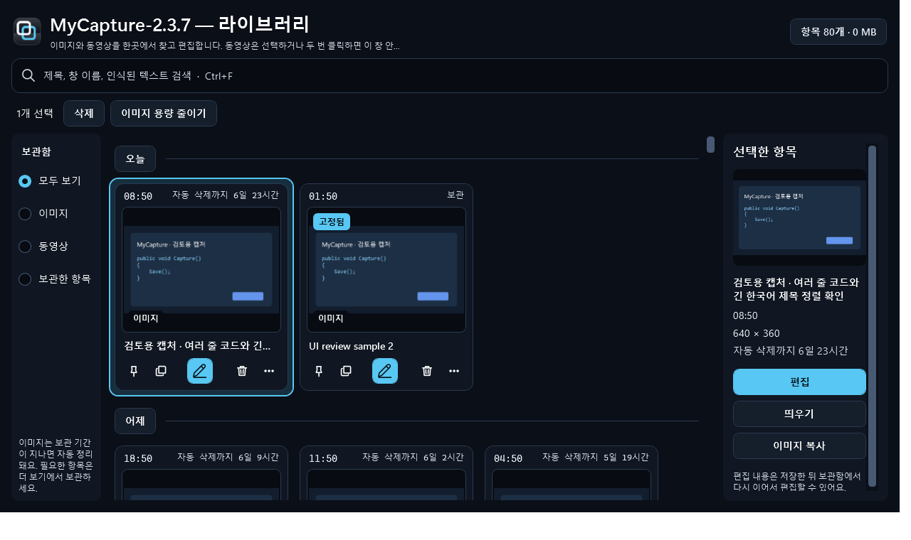
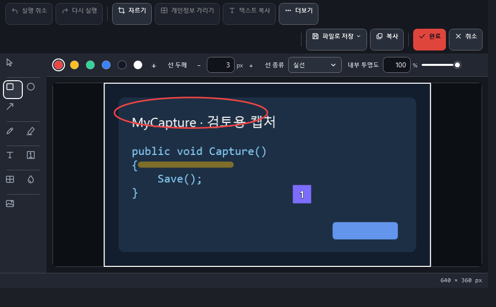
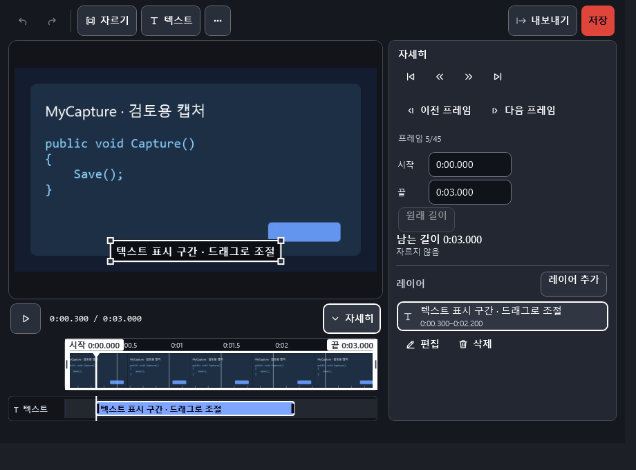
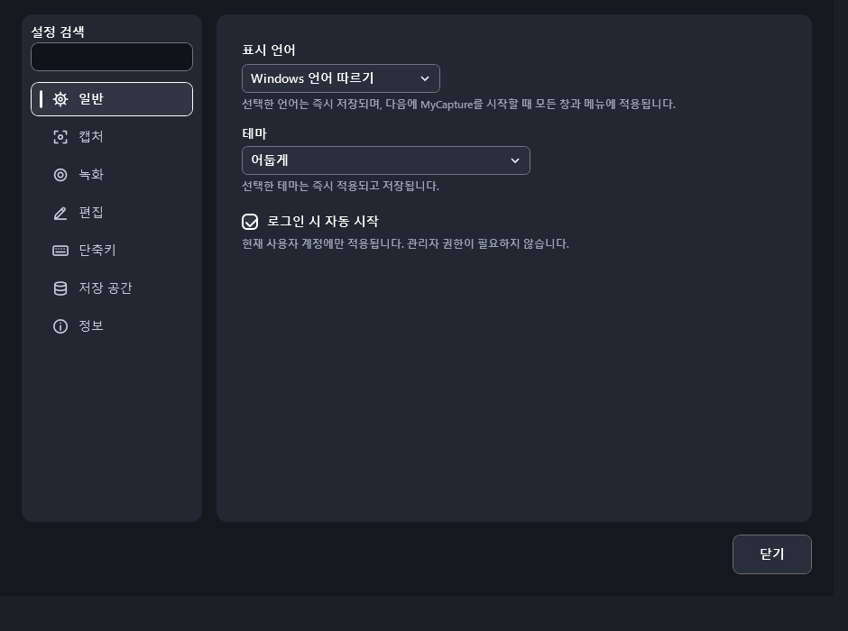

# MyCapture

MyCapture는 캡처, 주석 편집, 화면 고정(pin), OCR, 라이브러리, 영역 녹화를 한곳에 모은 Windows용 데스크톱 도구입니다. 캡처와 인식 결과는 기본적으로 사용자 PC 안에서 처리하며, 반복 작업은 전역 단축키와 트레이 메뉴로 빠르게 이어집니다.

> 현재 지원 하한은 **Windows 11 21H2(build 22000), x64**입니다. Windows 11 ARM64에서는 x64 에뮬레이션으로 실행할 수 있습니다. Windows 10은 지원하지 않습니다.

## 주요 기능

- 모니터 경계를 하나의 가상 데스크톱처럼 넘나드는 자유 영역 캡처·녹화와 창, 전체 화면, 지연 및 스크롤 캡처
- 영역을 고르는 중 포인터 아래 창을 강조하고 드래그 없이 클릭해 그 창을 선택(빈 바탕 화면은 포인터가 있는 모니터 전체), `C`로 포인터 아래 색을 HEX·RGB·HSL 형식으로 복사
- 사각형 선 종류와 채우기 투명도, 타원, 화살표, 연필, 형광펜, 단계 번호, 텍스트, 이미지 삽입, 모자이크, 강도를 다시 조절할 수 있는 블러(`B`)와 실행 취소/다시 실행을 제공하는 비파괴 주석 편집
- 클립보드 이미지·텍스트·엑셀 표를 항상 위에 보이는 창으로 고정하고 확대, 투명도, 클릭 통과, 복사, OCR 수행. 닫은 고정 창은 최근에 닫은 순서로 다시 열 수 있으며 기록은 메모리에만 보관
- 텍스트·표는 읽기 좋은 이미지로 렌더링하고, 지원하는 VS Code HTML의 코드 색상과 들여쓰기를 보존; `Ctrl+더블클릭`은 원문 또는 OCR 텍스트, 포커스된 창의 `Ctrl+C`는 이미지 복사
- 고정한 원본 이미지를 우클릭 메뉴 또는 `Ctrl+S`로 빠르게 PNG 저장하고, `Ctrl+Shift+S`로 저장 위치 선택
- Windows 로컬 OCR을 이용한 한국어·영어 혼합 텍스트, 작은 글자와 회전 이미지 인식 및 캡처 후 자동 라이브러리 색인
- 영역을 선택하면 텍스트만 인식해 클립보드에 복사하는 **텍스트 캡처**(전용 단축키, 트레이 메뉴, 캡처 중 `T`). 이미지는 라이브러리에 저장하지 않고, 알림에서 고급 추출로 이어 갈 수 있음
- 로컬 OCR로 이메일·한국 전화번호·주민번호 형태·카드번호·IP·주요 비밀 키를 찾아 편집 가능한 가림막을 한 번에 추가하는 **빠른 가리기**
- 이미지와 MP4를 명확히 구분해 함께 찾고, 별도 플레이어 없이 창 안에서 영상을 재생·편집하는 통합 라이브러리
- 날짜별 구분과 촬영 시각, Ctrl/Shift 범위 선택, 날짜 전체 선택, 선택 항목 삭제와 외부 폴더로 복사 드래그
- 라이브러리의 항목 수·용량 버튼에서 전체 비우기 범위를 확인한 뒤 삭제
- 영역 MP4 녹화와 일시정지·재개(컨트롤 창 버튼 또는 지정한 전역 단축키, 일시정지 구간은 영상에서 제외), 삭제 범위 핸들 자르기, 프레임 탐색, 시간 텍스트와 프레임 편집을 분리해 보존하는 비파괴 영상 레이어
- 녹화 영역 외곽선과 파일 변환·저장 상태 표시, 하단 텍스트 타임라인 양 끝을 이용한 표시 시간 조절
- 녹화 캡처 방식: 기본값 "자동"은 영역이 모니터 하나 안에 있으면 Windows Graphics Capture로, 여러 모니터에 걸치거나 사용할 수 없으면 GDI로 녹화. 녹화 화면에 문제가 있으면 설정의 녹화 탭에서 "호환 모드(GDI)"를 선택
- 선택 구간을 애니메이션 GIF로 내보내며 960px/10fps, 960px/5fps, 640px/10fps, 480px/5fps 품질 선택. 실제 GIF 인코더로 만든 약 3초 샘플을 실제 속도로 반복 재생하고(원본 비교·실제 크기 보기), 공유 목표 크기(5·10·15·20MB 또는 제한 없음)에 맞춘 예상 크기와 권장 설정을 안내. 화면이 바뀐 픽셀만 다시 그리고 같은 프레임은 합쳐, 화질을 낮추지 않고 파일 크기를 줄임. 길이 제한은 없음
- 영상 편집기의 내보내기 화면에서 MP4/GIF 형식 선택, 이미지·MP4 절감 목표와 계산된 실제 파일 크기 확인
- 앱 시작 준비 알림과 `MyCapture — 화면 이름` 창 제목, 이전 캡처 편집기에서 영역 캡처 단축키를 다시 눌러 재촬영
- 캡처 수와 저장 용량을 함께 제한하는 로컬 큐, 이미지의 7일 자동 보관 정리, 썸네일, 빠른 저장 폴더 설정
- 시스템 애니메이션 설정을 존중하는 짧고 일관된 전환과 키보드·스크린 리더 접근성

녹화는 화면 설명·편집·GIF 워크플로에 집중하며 마이크/시스템 오디오는 의도적으로 포함하지 않습니다. 설정에서 한국어·영어 또는 Windows 표시 언어 따르기와 테마(글래스 / 글래스 라이트 / 작업 공간 / 주간 / 자정 / 고대비)를 선택할 수 있습니다. 언어는 다음 앱 시작부터 적용되고, 테마는 선택하는 즉시 미리 볼 수 있고, 적용하면 저장됩니다. 취소하거나 설정창을 닫으면 저장된 테마로 돌아갑니다. 구현 범위와 검증 기록은 [`docs/`](docs/)에서 확인할 수 있습니다.

## 화면 둘러보기

| 기능 | 화면 |
|---|---|
| 통합 라이브러리 — 이미지·MP4, 날짜 묶음, 필터, 상세 패널 |  |
| 주석 편집기 — 사각형·화살표·연필·텍스트·이미지 레이어 |  |
| 영상 편집기 — 잘라내기, 텍스트 레이어, GIF/MP4 내보내기 |  |
| 설정 — 언어·테마·단축키·보관 정책 |  |

기능별 사용법과 녹화 → GIF 내보내기 흐름은 [사용법 가이드](docs/guides/README.md)에서 볼 수 있습니다. 가이드의 모든 스크린샷은 MyCapture의 UX 자가 검사가 실제 창을 렌더링해 생성한 것입니다.

## 기본 단축키

| 동작 | 기본값 | 비고 |
|---|---:|---|
| 영역 캡처 | `Ctrl+Shift+C` | 놓으면 라이브러리에 먼저 저장하고 클립보드에 복사한 뒤 편집기로 이동. Esc로 닫아도 원본 유지 |
| 라이브러리 열기 | `Ctrl+Shift+Z` | 이미지와 동영상을 함께 조회하고 동영상을 창 안에서 재생 |
| 영역 녹화 시작/중지 | `Ctrl+Shift+X` | 같은 키로 녹화 종료 |
| 클립보드 이미지·텍스트·표를 화면에 고정 | `F3` | PNG 투명도와 텍스트/표 원문을 보존. F9 이후에는 추출한 GitHub 이미지 URL을 고정 |
| 클립보드 이미지를 GitHub 첨부 URL로 | `F9` | 설정한 이슈 Write 칸에 붙여 넣고 user-attachments URL을 복사 |
| 모든 고정 이미지 숨기기/표시 | `Shift+F3` | 일괄 전환 |
| 편집기 빠른 저장 | `Ctrl+S` | PNG 저장 후 편집된 이미지를 클립보드에 복사 |
| 편집기 다른 이름으로 저장 | `Ctrl+Shift+S` | PNG 저장 후 편집된 이미지를 클립보드에 복사 |
| 편집기 빠른 가리기 | `Ctrl+Shift+R` | 로컬 OCR 민감정보 후보를 편집 가능한 가림막으로 추가 |
| 고정 이미지 빠른 저장 | `Ctrl+S` | 고정 창에 포커스가 있을 때 원본 PNG 저장 |
| 고정 이미지 다른 이름으로 저장 | `Ctrl+Shift+S` | 우클릭 메뉴에서도 실행 가능 |

창/전체 화면 캡처, 이전 영역 반복, 텍스트 캡처, 녹화 일시정지/재개, 닫은 화면 고정 다시 열기, 고정 창 클릭 통과 등의 전역 단축키는 설정에서 원하는 조합으로 지정할 수 있습니다. 단축키 충돌이 발생하면 기존 설정을 보존하고 적용을 취소합니다. `PrintScreen`을 지정했는데 Windows에서 Print Screen 키가 캡처 도구를 열도록 설정되어 있으면, 설정 화면에 안내와 Windows 설정 바로 가기를 표시합니다.

캡처할 때 대상 앱의 창 제목도 함께 기록합니다. Excel 문서명이나 VS Code 파일·프로젝트 이름은 앱이 제목 표시줄에 제공하는 범위에서 라이브러리 표시와 검색에 사용됩니다. 편집 후 저장하면 같은 라이브러리 항목의 편집 결과를 갱신합니다.

빠른 저장 파일명에는 `{title}` 토큰을 사용할 수 있습니다. 예를 들어 `{title}_{yyyyMMdd}_{HHmmss}`는 창 제목과 촬영 시각을 조합합니다. 새 설정의 기본값이며, 이전에 지정한 파일명 규칙은 유지됩니다. 설정에서 창 제목을 캡처 이미지 우측 상단에 표시할지도 선택할 수 있습니다. 제목 표시의 기본값은 끔입니다.

## 설치와 실행

MyCapture는 [Microsoft Store](https://apps.microsoft.com/detail/9PB33MC095VR)로만 배포합니다. Store 설치본은 Microsoft가 서명하고 업데이트도 Store가 제공합니다. 설정의 업데이트 탭은 Microsoft Store의 MyCapture 페이지를 엽니다. 이 저장소는 개발용 비공개 저장소이며, GitHub 릴리스(설치 파일·포터블 ZIP)는 4.0.2를 마지막으로 더 게시하지 않습니다. 사용자 지원과 개인정보처리방침은 공개 [지원 저장소](https://github.com/sukwoo0711-maker/mycapture-support)에 있습니다.

배포 패키지는 .NET 런타임을 포함하는 **self-contained** 빌드이므로 사용자 PC에 .NET을 따로 설치할 필요가 없습니다. 캡처, 편집, 녹화와 OCR은 PC 안에서 처리하며, 앱이 자동으로 인터넷에 연결하는 경우는 PC에 없는 OCR 모델 파일을 내려받을 때뿐입니다. 네트워크 연결 전체 목록은 [개인정보처리방침](https://github.com/sukwoo0711-maker/mycapture-support/blob/main/PRIVACY.md)에서 확인할 수 있습니다. Store 패키지를 만들고 제출하는 절차는 [Microsoft Store 배포](docs/store/README.md)를 참고하십시오.

`build\package.ps1`이 만드는 설치 파일과 포터블 ZIP은 Store 패키지의 원본 게시 폴더와 내부 확인용이며 서명되지 않습니다. 외부에 배포하지 마십시오.

기본 사용자 데이터 위치는 다음과 같습니다.

- Store 설치본의 설정, 인덱스, 라이브러리: 앱 전용 폴더 `%LOCALAPPDATA%\Packages\<패키지 패밀리 이름>\LocalState` (앱을 제거하면 함께 삭제)
- 개발 빌드(비패키지)의 설정, 인덱스, 로그: `%APPDATA%\MyCapture`, 라이브러리 관리 사본: `%APPDATA%\MyCapture\captures`
- 빠른 저장 PNG: `%USERPROFILE%\Pictures\Captures`

캡처 저장 폴더와 빠른 저장 폴더는 설정에서 변경할 수 있습니다. 라이브러리 이미지는 생성 후 기본 7일(168시간, 설정에서 변경 가능)이 지나면 오래된 순서대로 자동 삭제하며, 핀 고정하거나 편집 중인 이미지는 보관합니다. 동영상에는 7일 만료를 적용하지 않습니다. 따로 내보낸 파일은 관리 큐 정리 대상이 아닙니다. 개수·용량 제한은 별도로 적용됩니다.

4.1.0의 변경 사항은 [릴리스 노트](docs/releases/4.1.0-release-notes.md)에서 확인할 수 있습니다. 이전 [4.0.2](docs/releases/4.0.2-release-notes.md), [4.0.1](docs/releases/4.0.1-release-notes.md), [4.0.0](docs/releases/4.0.0-release-notes.md), [3.4.0](docs/releases/3.4.0-release-notes.md), [3.2.1](docs/releases/3.2.1-release-notes.md), [3.2.0](docs/releases/3.2.0-release-notes.md), [3.1.7](docs/releases/3.1.7-release-notes.md), [3.1.5](docs/releases/3.1.5-release-notes.md), [3.1.4](docs/releases/3.1.4-release-notes.md), [3.1.3](docs/releases/3.1.3-release-notes.md), [3.1.2](docs/releases/3.1.2-release-notes.md), [3.1.1](docs/releases/3.1.1-release-notes.md), [3.1.0](docs/releases/3.1.0-release-notes.md), [3.0.0](docs/releases/3.0.0-release-notes.md), [2.4.1](docs/releases/2.4.1-release-notes.md), [2.4.0](docs/releases/2.4.0-release-notes.md), [2.3.10](docs/releases/2.3.10-release-notes.md), [2.3.9](docs/releases/2.3.9-release-notes.md), [2.3.8](docs/releases/2.3.8-release-notes.md), [2.3.7](docs/releases/2.3.7-release-notes.md), [2.3.6](docs/releases/2.3.6-release-notes.md), [2.3.5](docs/releases/2.3.5-release-notes.md), [2.3.4](docs/releases/2.3.4-release-notes.md), [2.3.3](docs/releases/2.3.3-release-notes.md), [2.3.2](docs/releases/2.3.2-release-notes.md), [2.3.1](docs/releases/2.3.1-release-notes.md), [2.3.0](docs/releases/2.3.0-release-notes.md), [2.2.2](docs/releases/2.2.2-release-notes.md), [2.2.1](docs/releases/2.2.1-release-notes.md), [2.1.1](docs/releases/2.1.1-release-notes.md), [2.1.0](docs/releases/2.1.0-release-notes.md), [2.0.0](docs/releases/2.0.0-release-notes.md), [1.9.2](docs/releases/1.9.2-release-notes.md), [1.9.0](docs/releases/1.9.0-release-notes.md) 기록도 보존합니다.

### 1.8.3 실행 및 배포 형식 안내

- 일반 실행과 바로가기 더블클릭은 라이브러리 창을 엽니다. 로그인 자동 실행은 `--background`로 트레이에만 상주합니다.
- 설치형과 포터블 ZIP의 앱·런타임 파일은 동일합니다. 설치형은 `%LOCALAPPDATA%\Programs\MyCapture`에 설치하고 시작 메뉴, 제거 프로그램, `install-manifest.json` 소유권 기록을 추가합니다.
- 포터블은 ZIP 전체를 별도 폴더에 풀고 `MyCapture.exe`를 실행하십시오. EXE만 옮기면 DLL과 Assets가 없어 실행할 수 없습니다. 두 형식의 기본 사용자 데이터는 `%APPDATA%\MyCapture`입니다.
- 설치 전 다른 위치의 포터블/설치형을 트레이 메뉴에서 종료하십시오. 두 복사본은 한 Windows 세션에서 동시에 상주하지 않습니다.
- 설치형과 포터블은 앱 안에서 업데이트를 확인하거나 내려받지 않습니다. 업데이트 탭의 **Microsoft Store에서 열기**로 Store 버전을 설치하십시오. Store 버전은 설정·라이브러리를 공유하지 않으므로 설정 내보내기·가져오기로 설정을 옮기고, Store 버전을 실행하기 전에 기존 복사본을 트레이 메뉴에서 종료하십시오. 기존 폴더와 사용자 파일은 자동 삭제하지 않습니다.
- [1.8.3 수정 내역](docs/releases/1.8.3-release-notes.md)과 [검증 기록](docs/releases/1.8.3-validation.md)을 확인하십시오.

## 소스에서 빌드

배포본 실행과 달리 **소스 빌드에는 .NET 10 SDK가 필요**합니다. 이 저장소의 [`global.json`](global.json)은 검증한 SDK `10.0.400`을 기준으로 하고, 같은 .NET 10 계열의 더 최신 호환 feature band로 안전하게 roll-forward합니다. 런타임만 설치된 환경은 빌드할 수 없습니다.

필수 조건:

- Windows 11
- .NET 10 SDK `10.0.400` 이상
- Windows PowerShell 5.1 이상

```powershell
# SDK가 없다면 global.json에 고정된 버전을 현재 사용자 전용 폴더에 설치
# (관리자 권한, 레지스트리, 사용자 PATH 변경 없음)
powershell.exe -NoProfile -ExecutionPolicy Bypass -File build\bootstrap-sdk.ps1

# SDK, dotnet 경로와 호스트 정보를 진단
powershell.exe -NoProfile -ExecutionPolicy Bypass -File build\doctor.ps1

# Debug 빌드
powershell.exe -NoProfile -ExecutionPolicy Bypass -File build\build.ps1

# Release 빌드와 전체 단위/통합 테스트
powershell.exe -NoProfile -ExecutionPolicy Bypass -File build\build.ps1 -Configuration Release -Test
```

`bootstrap-sdk.ps1`은 Microsoft의 공식 `dotnet-install.ps1`을 사용해 정확한 SDK를 `%LOCALAPPDATA%\MyCapture\dotnet-sdk`에 설치합니다. `doctor.ps1`, `build.ps1`, `package.ps1`은 이 격리 SDK와 `%LOCALAPPDATA%\Microsoft\dotnet`의 일반 사용자별 SDK를 자동으로 찾고, 빌드 실패 시 `build\logs\`에 UTF-8 진단 로그를 남깁니다.

직접 실행하려면 다음 명령을 사용합니다.

```powershell
dotnet run --project src\MyCapture.App\MyCapture.App.csproj
```

앱은 트레이에 상주하므로 디버깅을 마칠 때 트레이 메뉴의 **종료**를 선택하십시오.

## 자체 진단(self-test)

출하용 실행 파일에는 실제 Windows 캡처·셸·OCR·녹화 경로를 확인하는 self-test가 포함되어 있습니다. 각 명령은 지정한 폴더에 보고서를 쓰며, WPF 실행 파일의 종료를 기다리도록 `Start-Process -Wait`를 사용해야 합니다.

```powershell
$exe = '<publish-folder>\MyCapture.exe'
$out = '<empty-output-folder>'

Start-Process -Wait -FilePath $exe -ArgumentList '--selftest-capture', $out
Start-Process -Wait -FilePath $exe -ArgumentList '--selftest-shell', $out
Start-Process -Wait -FilePath $exe -ArgumentList '--selftest-advanced', $out
Start-Process -Wait -FilePath $exe -ArgumentList '--selftest-settings', $out
Start-Process -Wait -FilePath $exe -ArgumentList '--selftest-ocr', $out
Start-Process -Wait -FilePath $exe -ArgumentList '--selftest-recording', $out
Start-Process -Wait -FilePath $exe -ArgumentList '--selftest-video-editor', $out
```

녹화 self-test는 설정과 관계없이 자동 방식(Windows Graphics Capture 우선)으로 녹화하며, 환경 변수 `MYCAPTURE_RECORDING_BACKEND`를 `gdi` 또는 `wgc`로 지정하면 그 방식으로 실행합니다. 셸 self-test는 실제 전역 단축키를 등록하므로 다른 MyCapture 인스턴스와 단축키 도구를 먼저 종료하는 편이 좋습니다. OCR 결과는 설치된 Windows 언어 팩에 영향을 받을 수 있습니다.

## 개인정보와 네트워크

MyCapture는 화면 픽셀, 캡처 기록, 설정, OCR 텍스트를 로컬 파일에 저장합니다. OCR은 Windows의 온디바이스 `Windows.Media.Ocr` 엔진과 PC에 내려받은 PP-OCRv5 모델로 처리하며, 현재 코드에는 캡처 자동 업로드나 제품 분석 텔레메트리가 없습니다. 필요한 OCR 모델 파일이 PC에 없으면 앱 시작 시 ModelScope(modelscope.cn)에서 내려받고, 선택 기능인 이미지 확대 모델은 처음 사용할 때 Amazon S3에서 내려받습니다. GitHub 이미지 첨부는 사용자가 직접 실행할 때만 연결합니다. 업데이트 확인은 앱이 직접 연결하지 않고 Microsoft Store 앱이나 브라우저에서 MyCapture 페이지를 엽니다. 전체 목록은 [개인정보처리방침](https://github.com/sukwoo0711-maker/mycapture-support/blob/main/PRIVACY.md)에 정리되어 있습니다. 빠른 가리기의 탐지 결과에는 인식 문자열을 복제하지 않고 종류·좌표만 유지하며, 추가된 가림막은 저장 전에 이동·삭제·실행 취소할 수 있습니다. 민감한 화면을 캡처했다면 빠른 저장 폴더, 캡처 큐, 클립보드와 로그의 보관 정책도 함께 확인하십시오.

보안 문제는 공개 이슈에 재현 자료를 올리지 말고 [`SECURITY.md`](SECURITY.md)의 비공개 신고 절차를 따르십시오. 개발 참여 방법은 [`CONTRIBUTING.md`](CONTRIBUTING.md)를 참고하십시오.

## 라이선스

MyCapture 자체 코드에는 [MIT License](LICENSE)가 적용됩니다. 배포 패키지에 포함되는 .NET/WPF 런타임과 기타 구성요소는 각각의 라이선스를 따르며, 자세한 출처와 배포 고지는 [`THIRD-PARTY-NOTICES.md`](THIRD-PARTY-NOTICES.md)에서 확인할 수 있습니다.

---

**English summary:** MyCapture is a Windows 11 screenshot, pin, enhanced local OCR, OCR-assisted privacy-redaction, unified image/video gallery, annotation, cross-monitor region-recording, timed-text video editing, and GIF-export app. MyCapture is distributed only through the [Microsoft Store](https://apps.microsoft.com/detail/9PB33MC095VR), which signs the package and delivers updates; the app never checks for or downloads updates itself, and Settings > Update opens the MyCapture page in the Store; this private repository is for development, and support lives in the public [support repository](https://github.com/sukwoo0711-maker/mycapture-support). Packages are self-contained and work without a preinstalled .NET runtime. Capture, editing, recording and OCR run on the PC; the only automatic network access is downloading missing OCR model files (see the [privacy policy](https://github.com/sukwoo0711-maker/mycapture-support/blob/main/PRIVACY.md)). The included bootstrap script can install the repository-pinned .NET 10 SDK for source builds without admin rights. Choose Korean, English, or the Windows display language in Settings; the saved choice applies on the next app start. Recording intentionally has no audio.
