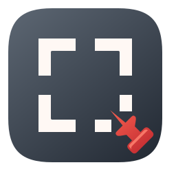

# MyCapture brand and visual system

**Corner Seal · Signal Magenta.** This document is the single source for the MyCapture mark,
colour, type, voice and Store presence. It replaces the "Iris Portal" mark and the Iris violet
accent used through 4.1.0.

## Brand promise

> **보이는 그대로, 내 PC에 남깁니다.**
> Keep what you see — on your PC.

MyCapture is a precision Windows capture tool built around one behaviour: the moment a dragged
region is released, the capture is kept. It is saved to the library and copied to the clipboard
before the editor opens, and it is still there if the editor is closed with Esc. Everything after
that (annotate, pin, read, redact, record, find again) happens on the user's PC.

## Five principles

1. **Pixels first — 화면이 주인공.** Chrome stays quiet graphite and the captured pixels are the
   largest, brightest thing on screen. Brand colour appears only at moments of intention:
   the one primary action, the current selection, keyboard focus and the capture guide.
2. **Kept on release — 놓는 순간 남는다.** A capture is never lost. Library-first save, clipboard
   copy, Esc keeps the original, and folders keep what matters past the retention window.
3. **Stays on your PC — 내가 보내기 전까지 PC 밖으로 나가지 않는다.** No account, ads,
   automatic upload or analytics. OCR runs on the device and Quick Redact covers sensitive text
   before anything is shared. The only network access is what the privacy policy lists
   (missing OCR model files, the optional upscaling model, user-initiated GitHub attachments).
4. **Always reversible — 언제든 되돌린다.** Annotations and video edits are layers over an
   untouched original, with undo/redo, and can be reopened later.
5. **Muscle memory — 손이 기억한다.** `Ctrl+Shift+C / X / Z` and `F3`. Drag operations keep a
   keyboard or button alternative, and icon-only controls carry names for screen readers.

The voice rule follows from these: say what happened and what comes next, without hype, and say
plainly what MyCapture does not do (recordings have no audio).

## Mark: Corner Seal

The frame is the region the user chose. The seal is stamped at the corner where the drag is
released: the moment the capture becomes theirs, the way an artist stamps a seal (낙관) in the
lower corner of a finished work. One quiet white frame and one point of colour is also the
interface principle in miniature.

Construction on a 24-unit grid (percentages of the icon size in brackets, as used by
`build/generate-icons.ps1`):

| Part | Geometry | Colour |
|---|---|---|
| Plate | rounded square inset 0.72 (3%), radius 5.28 (22%) | graphite tone `#1B2029` → `#0D1016`, inner edge `#F6F8FC` at 16% |
| Frame | stroke centre line 5.6 → 17.4 (23.3% → 72.5%), stroke 2.2 (9.2%, rounded to whole pixels), corner radius 2.2, round caps | `#F6F8FC` |
| Opening | right and bottom edges stop at 11.4 (47.5%; 43% at 24 px and below) | — |
| Seal | square 13.4 → 19.8 (55.8% → 82.5%), radius 1.5 (6.25%) | Signal Magenta `#F0369B` |

Rules:

- One seal, one colour. Never add a second accent, outline the seal or move it to another corner.
- Never rotate, skew, add effects, or show the open frame without its seal.
- The mark is not a command icon. Copy, duplicate and pin glyphs in the UI never reuse it. (The
  previous two-pane mark was indistinguishable from the Copy glyph.)
- Minimum size 16 px. Clear space of at least 25% of the plate on every side.
- Sources: `src/MyCapture.App/Assets/mycapture-mark.svg` (vector) and `build/generate-icons.ps1`
  (`app.ico`, tray icons, MSIX logos and the 300 × 300 Store tile). Every raster size is drawn
  natively, never scaled from another bitmap.

### Tray states

The tray uses the same plate and frame; only the seal changes. The tooltip and status text always
name the state, so colour is never the only cue.

| State | Seal | File |
|---|---|---|
| Idle | magenta square | `tray-idle.ico` (same art as `app.ico`) |
| Capturing / recording | amber **round** dot (REC) | `tray-capturing.ico` |
| Busy / exporting | emerald square | `tray-busy.ico` |
| Error | red square | `tray-error.ico` |

### Wordmark and lockup

- Wordmark: `MyCapture` in Segoe UI Variable Display Semibold; Korean `마이캡처` in Malgun Gothic
  Bold. Never stylise `My` and `Capture` differently in running text.
- Lockup: the mark at 1.5 × the cap height, followed by the wordmark at a gap of 0.4 × the mark.
- Marketing pieces may end the wordmark with the seal as a full stop (a small magenta square).
  Product UI text never does.

## Colour: Graphite and Signal Magenta

### Why magenta

- **It is never the content.** People capture Teams, Discord, Slack, GitHub and dashboards whose
  chrome is violet or blue. Iris violet sat at hue 247°, 9° from Teams' classic purple `#6264A7`
  (238°); Signal Magenta sits at 327°.
- **It is never an annotation.** The editor swatches are red, yellow, green, blue, black and white.
  A magenta frame on screen is always MyCapture's selection, never something the user drew.
- **It reads on any pixels.** Relative luminance 0.235 keeps it visible on white documents
  (3.68:1) and on dark editors (4.5:1 on `#1E1E1E`).
- **It is ours in the category.** Purple is already a capture-tool colour.

### Primitive

| Ramp | Values |
|---|---|
| Graphite (unchanged) | 980 `#080C12`, 950 `#0B0F17`, 900 `#101722`, 850 `#151E2B`, 800 `#1B2636`, 700 `#243246`, 600 `#475973`, 500 `#2B3A50`, 400 `#8E9CAF`, 300 `#C6D0DF`, 100 `#F6F8FC` |
| Signal Magenta | 100 `#FCE7F2`, 300 `#FF5CAB`, 400 `#F0369B`, 600 `#E22D8C`, 700 `#C41C72`, 800 `#A8125F`, 900 `#2B1527` |
| Ink | `#120810`, the only text colour on magenta fills |
| States | amber `#F5B942` (capturing, warning), emerald `#45D6A2` (done, busy), red `#FF6B5F` dark / `#C62828` light (error, destructive) |
| Layer identity | violet `#8B7BFF` / `#5A48E0` (video text layers), teal `#3FD8C9` / `#118F84` (frame layers) |

Layer identity colours label timeline layers; they are not brand colours and never mark selection.

### Semantic mapping

| Role | Dark themes (Midnight, Workspace, Glass) | Light themes (Daylight, Glass light) |
|---|---|---|
| `Accent.Default`, `Border.Accent` — the one primary action | M400 `#F0369B` | M400 `#F0369B` |
| `Accent.Hover` | M300 `#FF5CAB` | M300 `#FF5CAB` |
| `Accent.Pressed` | M600 `#E22D8C` | M600 `#E22D8C` |
| `Accent.Subtle` — selected wash | M900 `#2B1527` | M100 `#FCE7F2` |
| `Accent.Cool`, `Border.Focus`, `Overlay.SelectionBorder`, capture guide | M300 `#FF5CAB` | M700 `#C41C72` |
| `Timeline.Playhead` | white | M800 `#A8125F` |
| `Overlay.HandleStroke` | M700 `#C41C72` | M800 `#A8125F` |
| `Text.OnAccent` | Ink `#120810` | Ink `#120810` |
| `State.Danger` / hover | `#FF6B5F` / `#FF8A80` | `#C62828` / `#E0453A` |

High Contrast keeps its yellow system accent and follows the Windows system colours.

Rules:

- One magenta action per surface. Selection, focus and the capture guide are the only other magenta.
- Magenta never fills large areas, never decorates and never colours content. Synthetic pages in
  Store screenshots use a neutral product blue; sample annotations use the editor swatches.
- Dark ink on every magenta fill. White text on magenta is prohibited.
- Danger is a warm red more than 30° of hue away from magenta and always comes with an icon or label.

### Verified contrast

Every theme keeps the existing text/surface pairs (`ThemeContrastTests`) and the accent rules
(`ThemeResourceAvailabilityTests`). Measured for this palette:

| Pair | Ratio |
|---|---|
| Ink on M400 / M300 / M600 | 5.34 / 6.90 / 4.67 |
| Focus ring on base, lowest of all themes (Workspace gallery `#EDF3F2`) | 4.98 |
| Selection border on canvas, lowest of all themes (Daylight) | 5.12 |
| Primary fill against its surface, lowest (light themes) | 3.47 |
| Danger text on raised, lowest (Workspace) | 5.16 |
| Light-theme `Accent.Cool` text on white | 5.59 |

## Three token layers

### Primitive

Raw values only: the graphite ramp, the Signal Magenta ramp (canonical `Primitive.Magenta*` keys;
the historical `Primitive.Yellow*`, `Blue*` and `Violet*` slots alias them), ink and state colours.

### Semantic

- Canvas/Base/Raised/Overlay form a restrained four-step depth ladder.
- Accent is reserved for the single primary action, current selection and keyboard focus.
- Text.Primary, Text.Secondary and Text.Muted carry hierarchy without oversized typography.
- Warning, Success and Danger are operational states, not decorative accents.
- Timeline layer colours are semantic and distinct in both hue and hatch/label treatment.

### Component

- Hit targets are at least 36 px; compact controls are 32 px only where keyboard alternatives
  and surrounding spacing are available.
- Buttons, icon buttons, tabs, timeline handles and cards all expose default, hover, pressed,
  focused, selected and disabled states through shared resources.
- Keyboard focus is an inset 1 px high-contrast ring so layout never shifts.

## Typography and density

- UI: Segoe UI Variable Text, Segoe UI, Malgun Gothic. These are local/system fonts so the
  self-contained application remains fully offline.
- Display: Segoe UI Variable Display.
- Measurements use Cascadia Mono/Consolas: capture size (`720 × 420`), timecodes, frame numbers,
  file sizes. The size chip beside a selection is a precision cue and part of the brand.
- Scale: 12 / 13 / 14 / 17 / 24 / 28 px.
- Spacing follows a 4 px base with primary steps at 8 / 12 / 16 / 24 / 32 px.

## Voice and tone

Plain and exact. Korean uses 합니다체; English uses sentence case and plain verbs.

- **Outcome first, then the next step.** "라이브러리에 저장하고 클립보드에 복사했습니다."
- **Exact numbers and units.** "최대 20초", "7일 뒤 자동 정리", "960px · 10fps".
- **No hype.** No 최고의, 혁신적인, 완벽한, no exclamation marks, no claims a test has not shown.
- **Say the limits.** "녹화에는 소리가 없습니다." "Windows 10은 지원하지 않습니다."
- **Name things the same way everywhere.** 라이브러리, 화면 고정, 빠른 가리기, 텍스트 인식.

| Instead of | Write |
|---|---|
| 화면 캡처, 주석 편집, 로컬 OCR, 영역 녹화를 한곳에 모은 Windows용 캡처 도구입니다. | 영역을 놓는 순간 내 PC에 남는 캡처 도구. 주석, 화면 고정, 텍스트 인식, 빠른 가리기, 녹화까지 PC 안에서 처리합니다. |
| 강력한 OCR로 텍스트를 완벽하게 추출하세요! | 이미지 속 한국어·영어를 PC 안에서 읽어 텍스트와 표로 꺼냅니다. |

## Store presence

- **App tile icon (300 × 300):** generated by `build/generate-icons.ps1 -StoreListingIconPath`.
- **Screenshots:** the app's UI only. Store guidance asks for no added logos or marketing text and
  keeps critical content in the top two-thirds; each screenshot's caption (200 characters or
  fewer) carries the message instead. Captions live in `docs/store/listing.md`.
- **Backdrop:** a graphite (or paper) stage with one soft magenta glow, drawn by
  `StoreScreenshotSelfTest.Background`.
- **16:9 Super hero art:** `design-system/mycapture/store/hero.svg`, exported to
  `docs/store/assets/hero-3840x2160.png`. No text and no app UI: a dimmed abstract desktop, one
  selected region at full brightness, the open frame and the seal, all in the top two-thirds.

## Command family

The three primary workflow keys share one memorable modifier family:

- `Ctrl+Shift+C` — capture a region.
- `Ctrl+Shift+X` — start or stop region recording.
- `Ctrl+Shift+Z` — open the library.

Product copy, tooltips, onboarding and future command surfaces must keep this C/X/Z family
together. A lone `Ctrl+X` must never be described as the recording default because Windows
users reasonably read it as Cut.

## Motion

- Fast 83 ms for press/state feedback, normal 167 ms for window entry, deliberate 250 ms only
  for larger contextual changes.
- Animate opacity and transforms, never capture geometry or timeline dimensions.
- Motion stays interruptible and respects Windows reduced-animation settings.

## Accessibility guardrails

- Normal text pairs target WCAG AA (4.5:1); focus and non-text indicators target at least 3:1.
- Icon-only controls retain descriptive AutomationProperties.Name values and tooltips.
- Colour is reinforced by labels, shapes or hatching (the capturing tray seal also changes shape).
  Drag handles retain buttons/keyboard alternatives, and focus must remain visible while
  timelines scroll.

## Not yet done

- The guide screenshots in `docs/guides/shots/` and the published Store screenshots still show
  the Iris palette. Regenerate them on Windows with `--selftest-ux-review` and
  `--selftest-store-shots` after this palette ships.
- A brand moment for "kept" (the quick-action card's seal settling in on capture) is a proposal,
  not implemented.
