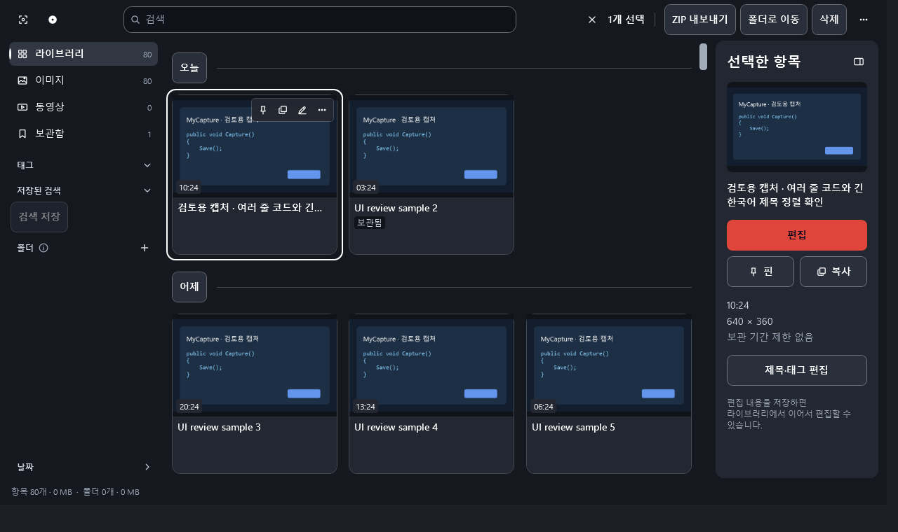
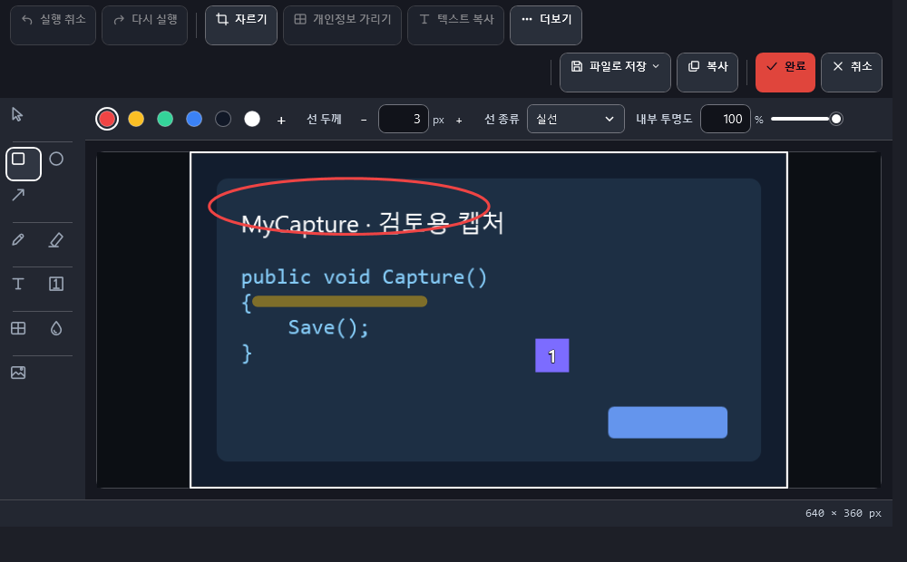
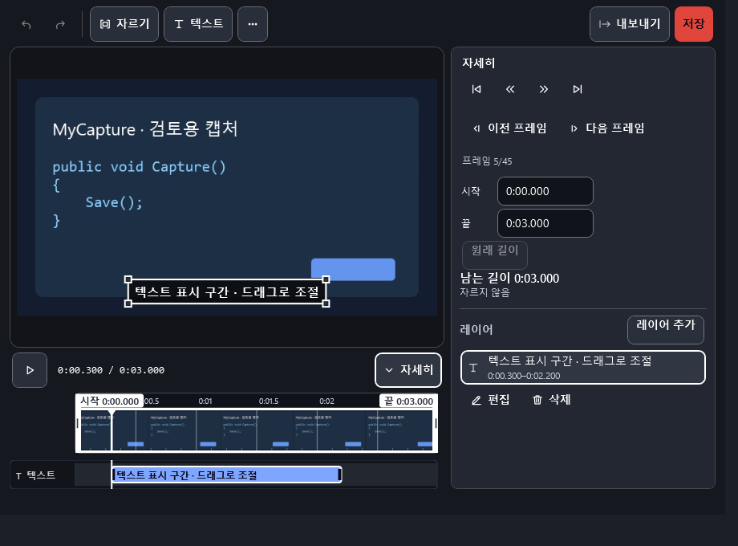
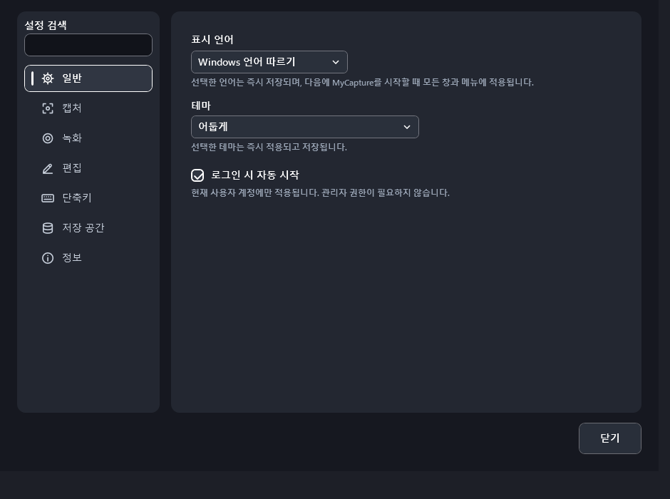

# MyCapture 기능과 화면

MyCapture 5.0.1의 기능, 화면과 단축키를 정리한 문서입니다. 짧은 소개와 기본 단축키 표는 [README](../README.md)에 있습니다.

MyCapture는 캡처, 이미지 편집, 핀으로 띄우기, 텍스트 인식, 라이브러리, 영역 녹화를 한곳에 모은 Windows용 데스크톱 도구입니다. 캡처와 인식 결과는 기본적으로 사용자 PC 안에서 처리하며, 반복 작업은 전역 단축키와 트레이 메뉴로 빠르게 이어집니다.

> 현재 지원 하한은 **Windows 10 버전 22H2(build 19045)**이며 x64와 x86(32비트 호환판)을 지원합니다. x86판은 Windows 기본 OCR만 사용하고, AI OCR과 로컬 번역은 x64판에서 제공합니다. ARM64의 x64 에뮬레이션은 Windows 11(build 22000) 이상에서 지원합니다.

## 주요 기능

- 모니터 경계를 하나의 가상 데스크톱처럼 넘나드는 자유 영역 캡처·녹화와 창, 전체 화면, 지연 및 스크롤 캡처
- 영역을 고르는 중 포인터 아래 창을 강조하고 드래그 없이 클릭해 그 창을 선택(빈 바탕 화면은 포인터가 있는 모니터 전체), `C`로 포인터 아래 색을 HEX·RGB·HSL 형식으로 복사, `R`로 16:9·4:3·1:1·9:16 비율이나 1280 × 720·1920 × 1080·1080 × 1080 고정 크기 선택, `F1`로 지금 쓸 수 있는 단축키 안내를 화면 구석에 켜고 끔
- 사각형 선 종류와 채우기 투명도, 타원, 화살표(머리 끝·양쪽·없음), 연필, 형광펜(연필·형광펜은 `Shift`를 누른 채 그리면 45° 단위 직선), 단계 번호, 텍스트, 이미지 삽입, 한 번 등록해 두고 매번 같은 자리에 찍는 워터마크(`S`), 모자이크(`M`)와 강도를 다시 조절할 수 있는 흐림(`B`)을 하나로 묶은 **가리기**와 실행 취소/다시 실행을 제공하는 비파괴 이미지 편집. 캡처를 실제 크기(100 %)로 보여 주며, 도구 속성은 캔버스 위 가로 속성 바에서 조절
- 편집기의 **복사하고 닫기**(`Ctrl+C`)는 편집한 이미지를 라이브러리에 저장하고 클립보드에 복사한 뒤 닫으며, **파일로 저장**은 빠른 저장과 다른 이름으로 저장을 제공. `Esc`는 한 겹씩 닫히고 맨 바깥에서는 편집기가 닫히며, 저장하지 않은 변경이 있으면 먼저 확인. 편집기가 열려 있어도 영역 캡처 단축키로 새 화면을 캡처할 수 있으며, 편집 중인 내용은 그대로 유지되고 새 캡처는 라이브러리에 저장되어 클립보드에 복사됨
- 클립보드 이미지·텍스트·엑셀 표를 다른 창 위에 항상 보이는 핀으로 띄우고 확대(휠 또는 테두리 끌기), 투명도, 뒤 창 클릭 허용(켠 핀의 오른쪽 위 손잡이로 바로 해제), 복사, 텍스트 인식 수행. 닫은 핀은 최근에 닫은 순서로 다시 열 수 있으며 기록은 메모리에만 보관. 열린 핀은 트레이 메뉴의 **열린 핀**에서 핀마다 작은 미리 보기와 이름(핀 글자의 첫 줄, 글자가 없으면 원본 창 제목이나 픽셀 크기)·종류(텍스트·코드·표·이미지)를 보고 골라 앞으로 가져오며, 고른 핀은 테두리가 두 번 깜빡여 위치를 알림. 핀의 오른쪽 클릭 메뉴 **숨기기**와 **이 핀만 보기**로 핀을 숨기고, 숨긴 핀(`숨김`으로 표시)은 **열린 핀**이나 **핀 모두 보이기**(`Shift+F3`)로 다시 보임
- 텍스트·표는 읽기 좋은 이미지로 렌더링하고, 지원하는 VS Code HTML의 코드 색상과 들여쓰기를 보존. 핀이 놓인 모니터 배율로 그려 고배율 화면에서도 선명하고, 배율이 다른 모니터로 옮기면 그 배율로 다시 그림; `Ctrl+더블클릭`은 원문 또는 인식한 텍스트, 포커스된 핀의 `Ctrl+C`는 원문이 있으면 원문과 이미지, 없으면 이미지 복사
- 원문이 있는 핀에서 `F2`(오른쪽 클릭 메뉴 **글자 선택**)를 누르면 한 줄이나 한 셀만 골라 `Ctrl+C`로 원문 그대로 복사. `Esc`로 끝냄
- 핀의 원본 이미지를 오른쪽 클릭 메뉴 또는 `Ctrl+S`로 빠르게 PNG 저장하고, `Ctrl+Shift+S`로 저장 위치 선택
- 핀이 Markdown은 문서로, Mermaid는 그림으로 표시(VS Code에서 복사한 Markdown·Mermaid 파일 포함, 다른 언어 코드는 코드 색상 유지). 핀의 **번역**은 이 PC 안에서 한국어와 영어 사이를 번역하며 번역 모델은 처음 번역할 때 한 번 내려받음. 그림 핀은 번역문을 원래 그림 위 같은 자리에 덧씌우고 **번역**을 다시 누르면 원본 그림으로 돌아가며, 오른쪽 클릭 메뉴의 **번역문 문서로 보기**와 **번역 그림으로 보기**로 두 보기를 오감. 덧씌운 상태에서 `Ctrl+C`는 덧씌운 그림과 번역문 텍스트를 함께 복사하고, `Ctrl+더블클릭`과 저장은 원본 그림을 사용. 번역 중에는 `번역 중 · 3/12`처럼 끝난 문장 수와 남은 시간을 표시
- Windows 로컬 OCR을 이용한 한국어·영어 혼합 텍스트, 작은 글자와 회전 이미지 인식 및 캡처 후 라이브러리 검색 자동 준비
- 인식 품질은 `빠름`·`보통`·`정확` 세 단계이며 `빠름`과 `보통`은 Windows 기본 인식 기능을 사용. `정확`은 Windows 인식기와 PP-OCR을 함께 돌려 줄마다 더 나은 결과를 고르며 처음 쓸 때 모델을 내려받음. 텍스트 인식 결과 창에서는 `정확하게 다시 인식`으로 바로 다시 읽고, 표 칸과 글자를 그 자리에서 고치며(`편집됨`, `원래대로`), 고른 부분만 복사하거나 `핀으로 띄우기`로 고친 내용까지 원문 그대로 핀에 올림
- 영역을 선택하면 텍스트만 인식해 클립보드에 복사하는 **텍스트 복사**(전용 단축키, 트레이 메뉴, 캡처 중 `T`). 이미지는 라이브러리에 저장하지 않고, 알림에서 텍스트 인식 창으로 이어 갈 수 있음
- 텍스트 인식 결과 창의 **번역** 보기: 영어 문단과 표 칸을 이 PC 안에서 한국어로 옮겨 원문 옆에 번호를 붙여 보여 줌. 숫자·식별자는 원문과 대조해 되돌리고, 되돌리지 못한 값은 블록마다 표시. 번역 모델(약 247 MB)은 기본으로 받지 않고 처음 번역을 켤 때 내려받으며 설정에서 삭제
- 로컬 OCR로 이메일·한국 전화번호·주민번호 형태·카드번호·IP·주요 비밀 키를 찾아 편집 가능한 가림막을 한 번에 추가하는 **개인정보 가리기**
- 이미지와 MP4를 함께 찾는 통합 라이브러리. 미리보기 중심의 이미지 타일에는 핀·복사·더 보기 단추가 항상 보이고, 선택 상자는 타일에 마우스를 올리거나 선택·키보드 포커스를 옮길 때 썸네일 왼쪽 위에 나타남. 캡처 시각은 제목 오른쪽에, 출처는 이미지 아래의 작은 아이콘(누르면 **출처 열기**, 메뉴에 **같은 출처 캡처 보기**)으로 표시. 영상은 앱의 동영상 창에서 재생·편집하며, 창을 늘리면 영상도 비율을 유지하며 커지고 전체 화면 단추나 `F11`로 화면을 채움. 타일에서 `P`는 핀으로 띄우기, `K`는 보관 전환, `M`은 폴더로 이동, `T`는 텍스트 인식, `G`는 GIF 내보내기, `F2`는 이름 바꾸기, `Alt+Enter`는 **정보**(파일 크기·해상도·길이·저장 위치). 라이브러리와 편집기에서 바로 새 캡처를 시작할 수 있음
- 날짜별 구분과 촬영 시각, Ctrl/Shift 범위 선택, 날짜 전체 선택, 선택 항목 삭제와 외부 폴더로 복사 드래그, 선택한 이미지로 **PDF로 만들기**
- 라이브러리 더보기 메뉴의 전체 라이브러리 비우기에서 삭제 범위를 확인한 뒤 삭제
- 영역 MP4 녹화와 일시정지·재개(컨트롤 창 버튼 또는 지정한 전역 단축키, 일시정지 구간은 영상에서 제외). 영상 편집기의 주요 명령은 자르기·텍스트·내보내기·저장이며, 자세히를 펼치면 프레임 이동·시작/끝 시간·레이어 목록을 표시. 시간 텍스트와 프레임 편집은 비파괴 레이어로 보존
- 녹화 영역 외곽선과 파일 변환·저장 상태 표시, 하단 텍스트 타임라인 양 끝을 이용한 표시 시간 조절
- 녹화에 글자나 이미지 워터마크를 넣을 수 있음(**설정 → 녹화**의 **워터마크 표시**와 **워터마크 설정…**, 기본값은 꺼짐). 동영상 플레이어와 영상 편집기의 **현재 장면 이미지로 저장**(`Shift+S`)은 지금 장면을 원본 해상도 그대로 라이브러리에 저장
- 녹화 방식: 기본값 "자동(권장)"은 영역이 모니터 하나 안에 있으면 Windows Graphics Capture로, 여러 모니터에 걸치거나 사용할 수 없으면 GDI로 녹화. 녹화 화면에 문제가 있으면 설정의 녹화 탭에서 "호환 모드"를 선택
- 선택 구간을 애니메이션 GIF로 내보내며 960px/10fps, 960px/5fps, 640px/10fps, 480px/5fps 품질 선택과 별도로 프레임 속도를 자동 또는 5·10·15·20·25·30·50fps에서 선택. 짧은 실제 GIF 샘플 미리보기(원본 비교·실제 크기 보기)와 공유 목표 크기(5·10·15·20MB 또는 제한 없음)에 맞춘 예상 크기와 권장 설정을 안내. 화면이 바뀐 픽셀만 다시 그리고 같은 프레임은 합쳐, 화질을 낮추지 않고 파일 크기를 줄임. 길이 제한은 없음
- 영상 편집기의 내보내기 화면에서 MP4/GIF 형식과 품질을 선택하고 저장 위치를 지정해 내보내기. MP4는 원본 화질·작게·더 작게와 고급의 파일 크기 감소 목표를 선택하고, 이미지도 별도 내보내기에서 용량 감소 목표를 조절
- 앱 시작 준비 알림과 `MyCapture — 화면 이름` 창 제목
- 캡처 수와 저장 용량을 함께 제한하는 로컬 보관함. 새 설치는 이미지 보관 시간 제한 없이 5 GiB / 1,000개까지 보관하며, 한도를 넘으면 보관하지 않은 오래된 항목부터 정리. 보관 기간·한도·빠른 저장 폴더는 설정에서 변경
- 처음 사용 연습: 단축키를 직접 눌러 보며 캡처, 그리기, 핀, 크기 바꾸기, 라이브러리에서 찾기를 익히는 단계별 연습(15단계, 단계마다 짧은 영상). 트레이 메뉴의 **도움말 → 처음 사용 안내**와 **설정 → 정보·지원**의 **처음 사용 안내**에서 다시 볼 수 있음. 트레이 메뉴의 **도움말 → 단축키 보기**(`F1`)에는 편집기·자르기·선택 화면·빠른 카드·라이브러리의 단축키가 모두 표시됨
- 새 버전 자동 확인: 새 버전이 있으면 라이브러리와 설정 창의 카드와 트레이 메뉴의 **업데이트 설치**로 알림. Microsoft Store 설치본은 Store 설치 화면으로, GitHub 설치형은 새 설치 파일을 내려받아 SHA-256을 확인한 뒤 앱이 직접 업데이트하며, 포터블 zip은 GitHub 릴리스 페이지를 엶. 캡처·녹화·편집 중에는 확인을 미루고, **설정 → 정보·지원**의 **새 버전 자동 확인**을 끄면 자동 확인을 하지 않음
- 시스템 애니메이션 설정을 존중하는 짧고 일관된 전환과 키보드·스크린 리더 접근성

녹화에는 마이크/시스템 오디오가 포함되지 않습니다. 설정은 캡처, 녹화, 편집, 핀, 텍스트·번역, 저장·보관, 단축키, 일반, 정보·지원의 아홉 범주로 나뉘며, **설정 찾기**로 항목을 찾고 효과가 애매한 설정 옆의 **변화 보기**로 바꾸기 전과 후를 그림으로 비교합니다. 한국어·영어·Windows 언어 따르기와 테마(시스템 따르기 / 밝게 / 어둡게 / 고대비)를 선택할 수 있고, 설정과 편집기 텍스트 도구의 글꼴 목록은 추천 글꼴로 줄었으며 **설치된 다른 글꼴…**에서 전체 글꼴을 고릅니다. 새 설치의 테마는 시스템 따르기입니다. 일반 테마의 포인트 색은 빨강으로 고정되며, 고대비에서는 시스템 접근성 색상을 사용합니다. 변경 사항은 별도의 적용 버튼 없이 자동으로 저장됩니다. 테마는 즉시 반영되고 언어는 다음 앱 시작부터 적용됩니다.

설정 초기화는 **설정 → 정보·지원 → 기본값으로 재설정**에서 실행합니다. 트레이 메뉴의 **도움말 → 문의하기**와 **설정 → 정보·지원**의 **문의하기**에서는 진단 정보 복사와 GitHub 이슈 작성을 사용할 수 있습니다. Store 설치판에서는 Store 리뷰도 열 수 있습니다. **설정 → 정보·지원**의 **진단 묶음 저장**은 최근 로그와 진단 정보를 ZIP 파일 하나로 저장하며 자동으로 전송하지 않습니다.

## 화면 둘러보기

| 기능 | 화면 |
|---|---|
| 통합 라이브러리 — 미리보기 중심 타일, 필터, 상세 패널 |  |
| 이미지 편집기 — 캔버스 위 속성 바, 도형·텍스트·이미지 삽입 |  |
| 영상 편집기 — 자르기·텍스트·내보내기·저장, 펼친 자세히 열 |  |
| 설정 — 항목 검색과 자동 저장 |  |

기능별 사용법과 녹화 → GIF 내보내기 흐름은 [사용법 가이드](guides/README.md)에서 볼 수 있습니다. 화면은 어둡게 테마를 사용하며, 영상 편집기는 자세히를 펼친 상태입니다.

## 기본 단축키

| 동작 | 새 설치 기본값 | 비고 |
|---|---|---|
| 영역 캡처 | `Ctrl+Shift+C` | 새 설치는 캡처 후 카드 표시. 카드 클릭 또는 `Alt+Q`로 활성화한 뒤 `E` 편집, `P` 핀, `S` 저장, `T` 텍스트 복사, `C` 이미지 복사. 카드에서는 `Ctrl+C`·`Ctrl+S`도 사용 |
| 영역 녹화 시작/중지 | `Ctrl+Shift+X` | 같은 키로 녹화 종료 |
| 지금 보는 그림 또는 클립보드의 이미지·텍스트·표를 핀으로 띄우기 | `F3` | 편집기에서는 편집한 그림을 핀으로 띄우고 편집을 마치며(편집기 명령 막대의 `핀`도 같음), 영역을 고르는 중에는 고른 영역을, 그 밖에는 클립보드를 핀으로 띄움. PNG 투명도와 텍스트/표 원문을 보존. 핀은 편집기 포커스를 가져가지 않음. 원문이 있는 핀에서 `Ctrl+C`는 원문 텍스트와 이미지를 함께 복사. GitHub 첨부 URL을 만든 뒤에는 추출한 GitHub 이미지 URL을 핀으로 띄움 |
| 라이브러리 열기 | 설정에서 지정(예: `Ctrl+Shift+Z`) | 이미지와 동영상을 함께 조회하고 앱의 동영상 창에서 재생 |
| 핀 모두 숨기기/보이기 | `Shift+F3` | 일괄 전환 |
| 클립보드 이미지를 GitHub 첨부 URL로 | 설정에서 지정(예: `F9`) | 설정한 이슈 Write 칸에 붙여 넣고 user-attachments URL을 복사 |
| 편집기 개인정보 가리기 | `Ctrl+Shift+R` | 편집기 안에서. 이 PC에서 인식한 개인정보 후보를 편집 가능한 가림막으로 추가 |
| 편집기 워터마크 추가 | `S` | 편집기 안에서. 한 번 등록한 로고나 블로그 이름을 등록한 위치에 일반 이미지로 추가. 처음에는 이미지 파일을 고르고, 도구 모음의 워터마크 단추를 오른쪽 클릭하면 워터마크 이미지 변경…, 불투명도(100/70/50/30%), 등록 이미지 해제 |
| 편집기 복사하고 닫기 | `Ctrl+C` | 편집기 안에서. 편집한 이미지를 라이브러리에 저장하고 클립보드에 복사한 뒤 닫음(`Ctrl+Enter`의 **완료**와 같음). 글상자에 입력하는 중에는 선택한 글자만 복사하고 닫지 않음 |
| 편집기 빠른 저장 | `Ctrl+S` | 편집기 안에서. PNG 저장 후 편집된 이미지를 클립보드에 복사하고 닫음. 파일 쓰기나 복사에 실패하면 열어 둠 |
| 편집기 다른 이름으로 저장 | `Ctrl+Shift+S` | 편집기 안에서. 저장 위치를 고른 뒤 PNG 저장, 클립보드 복사 후 닫음. 저장 창을 취소하면 아무것도 저장하지 않고 열어 둠 |
| 핀 이미지 빠른 저장 | `Ctrl+S` | 핀에 포커스가 있을 때 원본 PNG 저장 |
| 핀 이미지 다른 이름으로 저장 | `Ctrl+Shift+S` | 오른쪽 클릭 메뉴에서도 실행 가능 |
| 핀 글자 선택 | `F2` | 원문이 있는 핀(텍스트·표·코드)에서. 고른 부분만 `Ctrl+C`로 원문 복사, `Esc`로 끝냄 |
| 동영상 현재 장면 이미지로 저장 | `Shift+S` | 동영상 플레이어와 영상 편집기에서. 원본 해상도 그대로 라이브러리에 저장 |

새로 설치하면 전역 단축키는 영역 캡처, 영역 녹화, 클립보드 핀(`F3`), 핀 모두 숨기기/보이기(`Shift+F3`)가 정해져 있습니다. 다른 프로그램이 `F3`을 먼저 쓰고 있으면 시작할 때 알리고 설정의 단축키 항목으로 안내합니다. `Ctrl+Shift+Z`는 여러 편집기의 다시 실행 키라서 라이브러리 열기와 GitHub 첨부는 필요한 사람이 설정에서 지정합니다. 이전 버전부터 쓰던 설정은 저장된 키를 그대로 유지합니다.

처음 실행할 때(이전 버전에서 업데이트한 경우에는 업데이트 뒤 첫 실행에서 한 번) **핵심 단축키 지정** 질문이 나옵니다. **덮어쓰기**를 고르면 `Ctrl+Shift+C`(영역 캡처), `Ctrl+Shift+X`(영역 녹화 시작/중지), `Ctrl+Shift+Z`(라이브러리 열기), `F3`(핀)을 지정하고, 다른 프로그램이 먼저 등록한 같은 키도 MyCapture가 먼저 처리합니다. **그대로 두기**를 고르면 현재 키를 유지합니다. 이 선택은 나중에 **설정 → 단축키**에서 바꿀 수 있으며, 먼저 처리를 켜 두면 MyCapture가 실행 중인 동안 다른 프로그램의 같은 단축키(예: 파일 탐색기의 `F3` 검색)는 동작하지 않습니다.

새 설치에서는 종료할 때 열려 있던 핀을 다음 실행 때 같은 자리에 다시 띄웁니다. 핀은 더블클릭이나 Esc로 닫습니다. 두 동작은 **설정 → 핀**에서 바꿉니다.

새 설치에서는 캡처 후 작은 카드가 나타납니다. 캡처하면 카드가 뜨기 전에 클립보드 복사를 마치므로 카드가 보일 때 바로 붙여 넣을 수 있고, 복사가 1초를 넘는 아주 큰 캡처는 카드를 먼저 띄운 뒤 `복사 중…`으로 알립니다. 캡처 직후 편집기를 열려면 **설정 → 캡처 → 캡처 후 동작**에서 **편집기 열기**를 선택합니다. 이전 버전에서 사용하던 캡처 후 동작은 유지됩니다.

창/전체 화면 캡처, 이전 영역 반복, 텍스트 복사, 녹화 일시정지/재개, 닫은 핀 다시 열기, 핀의 뒤 창 클릭 허용 등의 전역 단축키는 설정에서 원하는 조합으로 지정할 수 있습니다. 충돌한 단축키는 저장하지 않고 기존 설정을 유지합니다. `PrintScreen`을 지정했는데 Windows에서 Print Screen 키가 캡처 도구를 열도록 설정되어 있으면, 설정 화면에 안내와 Windows 설정 바로 가기를 표시합니다.

캡처할 때 대상 앱의 창 제목도 함께 기록합니다. Excel 문서명이나 VS Code 파일·프로젝트 이름은 앱이 제목 표시줄에 제공하는 범위에서 라이브러리 표시와 검색에 사용됩니다. 편집 후 저장하면 같은 라이브러리 항목의 편집 결과를 갱신합니다.

빠른 저장 파일명에는 `{title}` 토큰을 사용할 수 있습니다. 예를 들어 `{title}_{yyyyMMdd}_{HHmmss}`는 창 제목과 촬영 시각을 조합합니다. 새 설정의 기본값이며, 이전에 지정한 파일명 규칙은 유지됩니다. 설정에서 창 제목을 캡처 이미지 우측 상단에 표시할지도 선택할 수 있습니다. 제목 표시의 기본값은 끔입니다.
