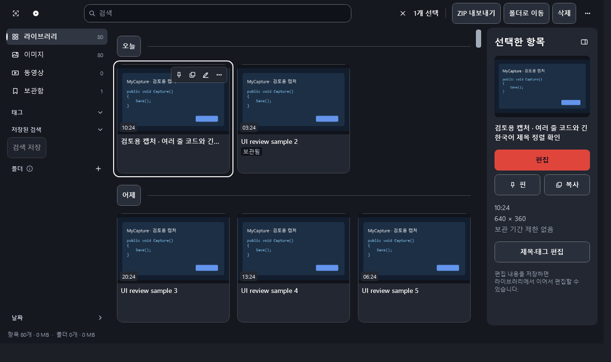

# 사용법 가이드

MyCapture 4.4.0의 캡처, 편집, 라이브러리와 설정 사용법입니다. 화면은 **어둡게** 테마를 기준으로 설명합니다.

## 1. 캡처와 빠른 카드

새로 설치하면 전역 단축키는 **영역 캡처 `Ctrl+Shift+C`**, **영역 녹화 시작/중지 `Ctrl+Shift+X`**, **클립보드 핀 `F3`**, **핀 모두 숨기기/보이기 `Shift+F3`**가 지정되어 있습니다. 라이브러리 열기와 GitHub 첨부 URL 만들기는 **설정 → 단축키**에서 지정합니다. 이전 버전에서 사용하던 단축키는 유지됩니다.

영역 캡처를 마치면 작은 카드가 나타납니다. 카드를 클릭하거나 `Alt+Q`를 눌러 활성화한 다음 작업을 선택합니다.

| 키 | 동작 |
|---|---|
| `E` | 편집 |
| `P` | 핀으로 띄우기 |
| `S` | 저장 |
| `T` | 텍스트 복사 |
| `C` | 이미지 복사 |

캡처 직후 편집기를 열려면 **설정 → 일반 → 캡처 후 동작**에서 **편집기 열기**를 선택합니다. 기존 사용자는 저장된 캡처 후 동작을 유지합니다.

## 2. 라이브러리 — 캡처와 영상 찾기

트레이 메뉴에서 라이브러리를 열거나 설정에서 지정한 단축키를 사용합니다. 이미지와 MP4를 함께 찾고, 왼쪽의 이미지·동영상·보관함 필터로 범위를 좁힐 수 있습니다. 이미지 타일을 선택하면 오른쪽 상세 패널에서 시간·크기·보관 상태를 확인하고 편집·핀·복사를 실행합니다.

- 검색창(`Ctrl+F`)에서 제목, 창 이름, 인식된 텍스트를 찾습니다.
- 이미지 타일에 마우스를 올리거나, 타일을 선택하거나, 키보드 포커스를 옮기면 핀·복사·편집·더보기 버튼이 나타납니다.
- 타일에 키보드 포커스가 있을 때 `P`는 핀으로 띄우기, `K`는 보관 전환입니다. 캡처 후 카드의 `P`와 같은 뜻입니다.
- 여러 항목은 `Ctrl`/`Shift` 클릭으로 선택해 삭제하거나 ZIP으로 내보낼 수 있습니다.
- 새 설치의 이미지는 보관 시간 제한이 없습니다. 전체 보관 한도는 **5 GiB / 1,000개**이며, 한도를 넘으면 보관하지 않은 오래된 항목부터 정리합니다. 보관 기간과 한도는 설정에서 변경할 수 있습니다.

## 3. 이미지 편집기 — 캡처 위에 표시

캡처 후 카드에서 **편집**을 선택하거나 라이브러리에서 이미지를 엽니다. 왼쪽에서 사각형·화살표·연필·텍스트 등의 도구를 선택하고, **캔버스 위 가로 속성 바**에서 색·선 두께·선 종류·내부 투명도를 조절합니다. 창이 좁으면 속성 바가 줄바꿈됩니다.

- 편집 내용은 비파괴 레이어로 보존되며 실행 취소/다시 실행이 가능합니다.
- `Ctrl+C`는 이미지 복사, `Ctrl+S`는 PNG 저장 후 이미지 복사입니다.
- `Ctrl+Shift+R`(**개인정보 가리기**)은 로컬 OCR로 전화번호·카드번호·API 키 같은 민감정보 후보를 찾아 편집 가능한 가림막을 추가합니다.

## 4. 영상 편집기 — 자르기, 텍스트, 내보내기

영역 녹화(`Ctrl+Shift+X`)를 중지하면 영상 편집기가 열립니다. 위쪽의 **자르기·텍스트·내보내기·저장**으로 주요 작업을 수행합니다. 남길 구간은 타임라인 손잡이로 조절하며, 텍스트는 화면 위치와 표시 시간을 편집할 수 있습니다.

**자세히**를 펼치면 오른쪽 열에 프레임 이동, 시작·끝 시간 입력과 레이어 목록이 나타납니다. 아래 화면은 자세히를 펼친 상태입니다.

**저장**은 자르기와 레이어 편집을 라이브러리의 녹화에 적용합니다. **내보내기**는 편집 결과로 새 MP4 또는 GIF 파일을 만듭니다.

GIF 내보내기:

1. 위쪽 **내보내기**를 선택합니다.
2. 형식에서 **GIF**를 선택합니다. 품질(960px/10fps, 960px/5fps, 640px/10fps, 480px/5fps), 재생 속도와 공유 목표 크기를 정하면 GIF 샘플 미리보기와 예상 크기, 권장 설정이 표시됩니다.
3. **내보내기**를 누르고 저장 위치와 파일 이름을 지정합니다. 변환을 마치면 선택한 위치에 GIF가 저장됩니다.

MP4는 **파일 크기**에서 **원본 화질·작게·더 작게**를 선택합니다. 필요한 경우 **고급**에서 파일 크기 감소 목표를 조절한 뒤 **내보내기**를 누르고 저장 위치를 지정합니다.

## 5. 설정 — 검색과 자동 저장

설정 왼쪽 위 **설정 검색**으로 원하는 항목을 찾습니다. 변경 사항은 자동으로 저장되며 별도의 적용 버튼은 없습니다. 테마는 즉시 반영되고, 언어는 다음 앱 시작부터 적용됩니다.

- 언어: 한국어 / 영어 / Windows 언어 따르기
- 테마: **시스템 따르기 / 밝게 / 어둡게 / 고대비**. 새 설치는 시스템 따르기이며, 일반 테마의 포인트 색은 빨강으로 고정됩니다. 고대비에서는 시스템 접근성 색상을 사용합니다.
- **정보 → 기본값으로 재설정**에서 설정을 초기화합니다.
- 트레이 메뉴 또는 **설정 → 정보 → 문의하기**에서 진단 정보 복사와 GitHub 이슈 작성을 사용할 수 있습니다. Store 설치판에서는 Store 리뷰도 열 수 있습니다.

## 6. 녹화한 화면을 GIF로 저장

1. **영역 녹화**(`Ctrl+Shift+X`)로 설명할 화면을 녹화합니다. 녹화에는 오디오가 포함되지 않습니다.
2. 녹화를 마치고 영상 편집기에서 타임라인 손잡이로 핵심 구간만 남깁니다.
3. **내보내기 → GIF**에서 품질과 속도를 선택한 뒤 **내보내기**를 누르고 저장 위치와 파일 이름을 지정합니다.

GIF 크기는 구간 길이에 비례해 커집니다. 내보내기 화면의 예상 크기와 권장 설정을 확인하고, 목표 크기를 넘으면 구간을 줄이거나 MP4로 내보내십시오.
