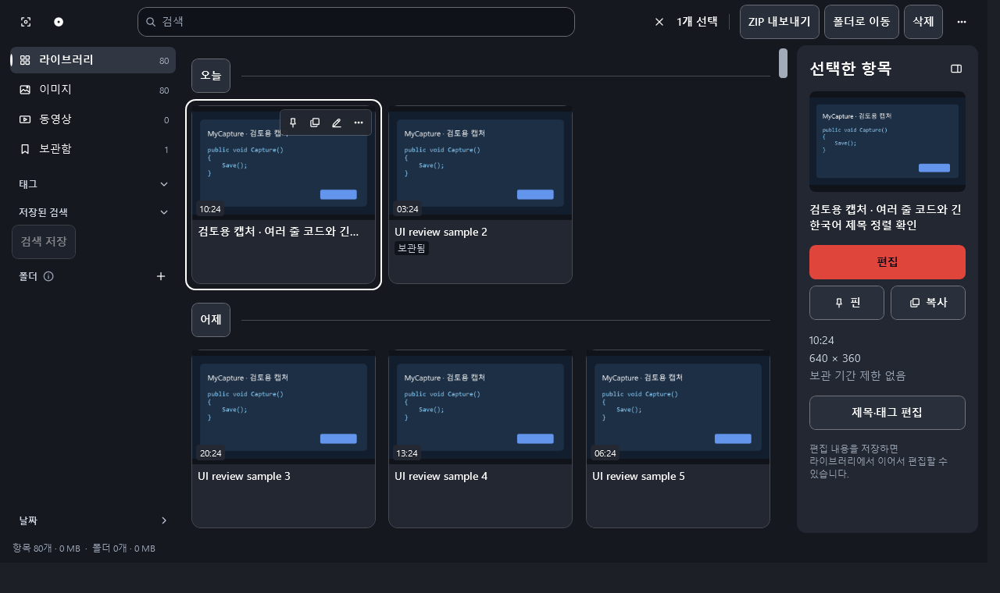
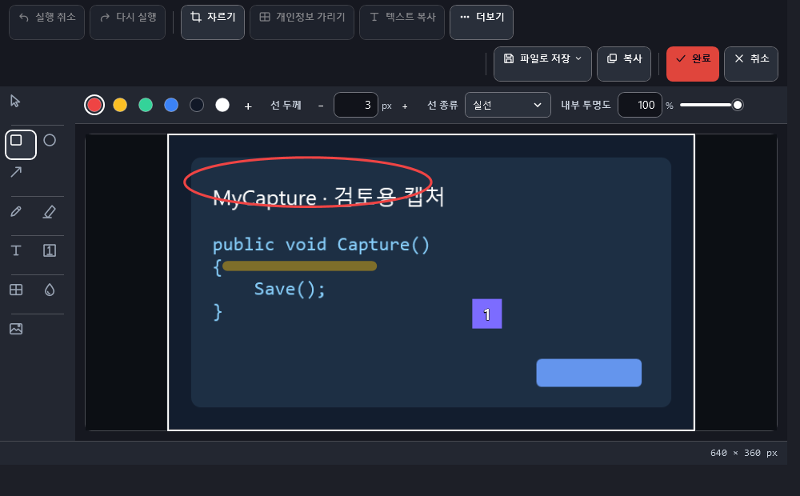
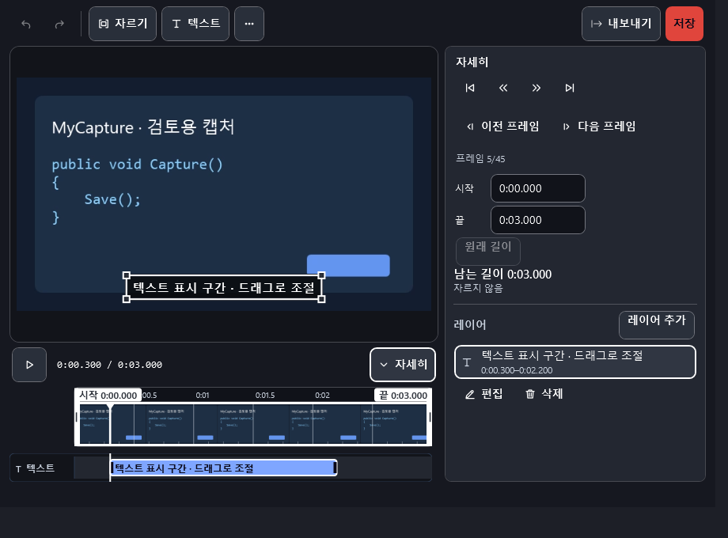
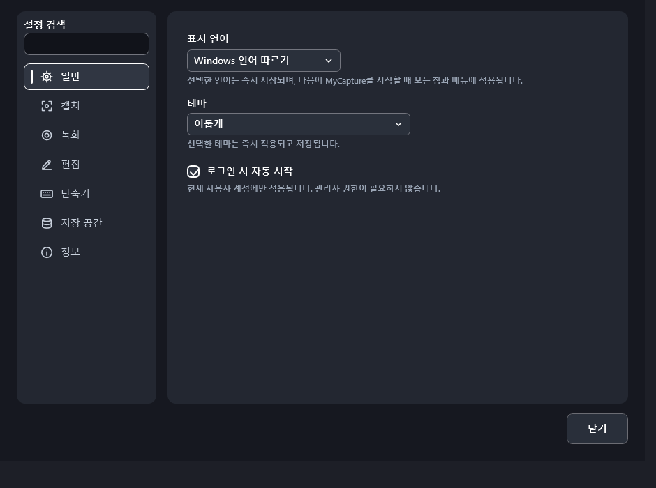

# 사용법 가이드

MyCapture 5.0.1의 캡처, 편집, 라이브러리와 설정 사용법입니다. 화면은 **어둡게** 테마를 기준으로 설명합니다.

## 1. 캡처와 빠른 카드

새로 설치하면 전역 단축키는 **영역 캡처 `Ctrl+Shift+C`**, **영역 녹화 시작/중지 `Ctrl+Shift+X`**, **편집·선택 중인 그림 또는 클립보드 핀 `F3`**, **핀 모두 숨기기/보이기 `Shift+F3`**가 지정되어 있습니다. 라이브러리 열기와 GitHub 첨부 URL 만들기는 **설정 → 단축키**에서 지정합니다. 이전 버전에서 사용하던 단축키는 유지됩니다. 처음 실행할 때 나오는 **핵심 단축키 지정**에서 **덮어쓰기**를 고르면 `Ctrl+Shift+Z`(라이브러리 열기)도 지정되고, 다른 프로그램이 먼저 등록한 같은 키도 MyCapture가 먼저 처리합니다.

영역을 고르는 중 `R`을 누르면 16:9·4:3·1:1·9:16 비율이나 1280 × 720·1920 × 1080·1080 × 1080 고정 크기를 고를 수 있고, `F1`은 지금 쓸 수 있는 단축키 안내를 화면 구석에 켜고 끕니다.

영역 캡처를 마치면 작은 카드가 나타납니다. 캡처하면 카드가 뜨기 전에 클립보드 복사를 마치므로 카드가 보일 때 바로 붙여 넣을 수 있고, 복사가 1초를 넘는 아주 큰 캡처는 카드를 먼저 띄운 뒤 `복사 중…`으로 알립니다. 카드를 클릭하거나 `Alt+Q`를 눌러 활성화한 다음 작업을 선택합니다. 카드에서는 `Ctrl+C`·`Ctrl+S`도 사용할 수 있습니다.

| 키 | 동작 |
|---|---|
| `E` | 편집 |
| `P` | 핀으로 띄우기 |
| `S` | 저장 |
| `T` | 텍스트 복사 |
| `C` | 이미지 복사 |

캡처 직후 편집기를 열려면 **설정 → 캡처 → 캡처 후 동작**에서 **편집기 열기**를 선택합니다. 기존 사용자는 저장된 캡처 후 동작을 유지합니다.

핀은 다음처럼 사용합니다.

- `F3`은 편집기에서는 편집한 그림을 핀으로 띄우고 편집을 마치며, 영역을 고르는 중에는 고른 영역을, 그 밖에는 클립보드의 이미지·텍스트·표를 핀으로 띄웁니다. 핀 테두리를 끌거나 휠을 굴려 크기를 바꿉니다.
- 핀의 오른쪽 클릭 메뉴에서 **숨기기**와 **이 핀만 보기**를 고를 수 있습니다. 숨긴 핀은 트레이 메뉴의 **열린 핀**에서 고르거나 **핀 모두 보이기**(`Shift+F3`)로 다시 보입니다. **열린 핀**은 핀마다 작은 미리 보기와 이름을 보여 주며, 고른 핀은 앞으로 나오면서 테두리가 두 번 깜빡입니다.
- 핀의 **번역**은 이 PC 안에서 한국어와 영어 사이를 번역합니다. 번역 모델은 처음 번역할 때 한 번 내려받습니다. 그림 핀은 번역문을 원래 그림 위 같은 자리에 덧씌우며, **번역**을 다시 누르면 원본 그림으로 돌아갑니다. 오른쪽 클릭 메뉴의 **번역문 문서로 보기**와 **번역 그림으로 보기**로 두 보기를 오갈 수 있습니다. 덧씌운 상태에서 `Ctrl+C`는 덧씌운 그림과 번역문 텍스트를 함께 복사하고, `Ctrl+더블클릭`과 저장은 원본 그림을 사용합니다.

처음 사용 연습은 트레이 메뉴의 **도움말 → 처음 사용 안내**나 **설정 → 정보·지원**의 **처음 사용 안내**에서 다시 볼 수 있습니다.

## 2. 라이브러리 — 캡처와 영상 찾기

트레이 메뉴에서 라이브러리를 열거나 설정에서 지정한 단축키를 사용합니다. 이미지와 MP4를 함께 찾고, 왼쪽의 이미지·동영상·보관함 필터로 범위를 좁힐 수 있습니다. 이미지 타일을 선택하면 오른쪽 상세 패널에서 시간·크기·보관 상태를 확인하고 편집·핀·복사를 실행합니다. 상세 패널은 **상세 정보 숨기기**로 접고 **상세 정보 보기**로 다시 엽니다. 라이브러리의 **새 캡처**에서 영역 캡처, 전체 화면, 창 캡처, 화면 녹화를 바로 시작할 수 있습니다.

- 검색창(`Ctrl+F`)에서 제목, 창 이름, 인식된 텍스트를 찾습니다.
- 이미지 타일에는 **핀으로 띄우기**·**이미지 복사**·**더 보기** 단추가 늘 보입니다. 선택 상자는 타일에 마우스를 올리거나, 타일을 선택하거나, 키보드 포커스를 옮길 때 썸네일 왼쪽 위에 나타납니다.
- 캡처 시각은 제목 오른쪽에 표시합니다. 출처는 이미지 아래의 작은 아이콘으로 표시하며, 누르면 **출처 열기**로 원래 페이지·파일·앱을 엽니다.
- 타일에 키보드 포커스가 있을 때 `P`는 핀으로 띄우기, `K`는 보관 전환, `M`은 폴더로 이동, `T`는 텍스트 인식(이미지), `G`는 GIF 내보내기(동영상), `F2`는 이름 바꾸기, `Alt+Enter`는 **정보**(파일 크기·해상도·길이·저장 위치)입니다. 한글 입력 상태에서도 동작하며, `P`는 캡처 후 카드의 `P`와 같은 뜻입니다.
- 여러 항목은 `Ctrl`/`Shift` 클릭으로 선택해 삭제하거나 ZIP으로 내보내거나, 이미지를 **PDF로 만들기**로 묶을 수 있습니다.
- 동영상 재생 창을 늘리면 영상도 비율을 유지하며 함께 커집니다. 전체 화면 단추나 `F11`로 화면을 채우고, `Esc` 또는 `F11`로 이전 창 크기와 위치로 돌아옵니다.
- 새 설치의 이미지는 보관 시간 제한이 없습니다. 전체 보관 한도는 **5 GiB / 1,000개**이며, 한도를 넘으면 보관하지 않은 오래된 항목부터 정리합니다. 보관 기간과 한도는 설정에서 변경할 수 있습니다.

## 3. 이미지 편집기 — 캡처 위에 표시

캡처 후 카드에서 **편집**을 선택하거나 라이브러리에서 이미지를 엽니다. 왼쪽에서 사각형·화살표·연필·텍스트 등의 도구를 선택하고, **캔버스 위 가로 속성 바**에서 색·선 두께·선 종류·내부 투명도를 조절합니다. 창이 좁으면 속성 바가 줄바꿈됩니다.

- 편집 내용은 비파괴 레이어로 보존되며 실행 취소/다시 실행이 가능합니다. 캡처는 실제 크기(100 %)로 표시됩니다.
- **가리기**는 모자이크(`M`)와 흐림(`B`)을 한 도구로 묶었습니다. **워터마크**(`S`)는 한 번 등록한 로고나 이름 그림을 같은 자리에 찍으며, 단추를 오른쪽 클릭하면 **워터마크 이미지 변경…**, **불투명도**, **등록 이미지 해제**를 쓸 수 있습니다.
- 연필과 형광펜은 `Shift`를 누른 채 그리면 누른 점에서 45° 단위 직선으로 그립니다. 화살표 머리는 속성 바에서 끝·양쪽·없음으로 고릅니다.
- `Ctrl+C`(**복사하고 닫기**)는 편집한 이미지를 라이브러리에 저장하고 클립보드에 복사한 뒤 편집기를 닫습니다(**완료**, `Ctrl+Enter`와 같음). 글상자에 입력하는 중의 `Ctrl+C`는 선택한 글자만 복사합니다. `Ctrl+S`는 PNG로 저장하고 이미지를 클립보드에 복사한 뒤 편집기를 닫습니다. `Ctrl+Shift+S`는 저장 위치를 고르는 **다른 이름으로 저장**이며 마지막으로 저장한 폴더를 기억합니다. 둘은 오른쪽 위 **파일로 저장** 메뉴에도 있습니다.
- `Esc`는 한 겹씩 닫히고 맨 바깥에서는 편집기가 닫히며, 저장하지 않은 변경이 있으면 먼저 묻습니다.
- 편집기가 열려 있어도 영역 캡처 단축키로 새 화면을 캡처할 수 있습니다. 편집 내용은 유지되고, 새 캡처는 라이브러리에 저장하고 클립보드에 복사합니다.
- `Ctrl+Shift+R`(**개인정보 가리기**)은 로컬 OCR로 전화번호·카드번호·API 키 같은 민감정보 후보를 찾아 편집 가능한 가림막을 추가합니다.

## 4. 영상 편집기 — 자르기, 텍스트, 내보내기

영역 녹화(`Ctrl+Shift+X`)를 중지하면 영상 편집기가 열립니다. 위쪽의 **자르기·텍스트·내보내기·저장**으로 주요 작업을 수행합니다. 남길 구간은 타임라인 손잡이로 조절하며, 텍스트는 화면 위치와 표시 시간을 편집할 수 있습니다.

**자세히**를 펼치면 오른쪽 열에 프레임 이동, 시작·끝 시간 입력과 레이어 목록이 나타납니다. 아래 화면은 자세히를 펼친 상태입니다.

재생 위치의 장면은 **현재 장면 이미지로 저장**(`Shift+S`)으로 원본 해상도 그대로 라이브러리에 저장합니다. 녹화에 글자나 이미지 워터마크를 넣으려면 **설정 → 녹화**의 **워터마크 표시**를 켜고 **워터마크 설정…**에서 종류와 위치를 정합니다. 기본값은 꺼짐입니다.

**저장**은 자르기와 레이어 편집을 라이브러리의 녹화에 적용합니다. **내보내기**는 편집 결과로 새 MP4 또는 GIF 파일을 만듭니다.

GIF 내보내기:

1. 위쪽 **내보내기**를 선택합니다.
2. 형식에서 **GIF**를 선택합니다. **GIF 크기**(표준 · 960px, 선명하게 · 960px, 작게 · 640px, 최소 용량 · 480px), **프레임 속도**, **재생 속도**와 **공유 목표 크기**를 정하면 GIF 샘플 미리보기와 예상 크기, 권장 설정이 표시됩니다. 프레임 속도를 자동으로 두면 GIF 크기에 따라 10fps 또는 5fps이고, 직접 고르면 5·10·15·20·25·30·50fps에서 선택합니다.
3. **내보내기**를 누르고 저장 위치와 파일 이름을 지정합니다. 변환을 마치면 선택한 위치에 GIF가 저장됩니다.

MP4는 **파일 크기**에서 **원본 화질·작게·더 작게**를 선택합니다. 필요한 경우 **고급**에서 파일 크기 감소 목표를 조절한 뒤 **내보내기**를 누르고 저장 위치를 지정합니다.

## 5. 설정 — 검색과 자동 저장

설정 왼쪽 위 **설정 찾기**로 원하는 항목을 찾습니다. 설정은 캡처, 녹화, 편집, 핀, 텍스트·번역, 저장·보관, 단축키, 일반, 정보·지원의 아홉 범주로 나뉩니다. 효과가 애매한 설정 옆의 **변화 보기**를 누르면 바꾸기 전과 후를 그림으로 비교합니다. 변경 사항은 자동으로 저장되며 별도의 적용 버튼은 없습니다. 테마는 즉시 반영되고, 언어는 다음 앱 시작부터 적용됩니다.

- 언어: 한국어 / 영어 / Windows 언어 따르기
- 테마: **시스템 따르기 / 밝게 / 어둡게 / 고대비**. 새 설치는 시스템 따르기이며, 일반 테마의 포인트 색은 빨강으로 고정됩니다. 고대비에서는 시스템 접근성 색상을 사용합니다.
- **텍스트·번역**에서 인식 품질(`빠름`·`보통`·`정확`)을 고르고 번역 모델을 확인·삭제합니다. `정확`은 처음 쓸 때 모델을 내려받습니다.
- **정보·지원 → 기본값으로 재설정**에서 설정을 초기화합니다.
- 트레이 메뉴 **도움말 → 문의하기** 또는 **설정 → 정보·지원 → 문의하기**에서 진단 정보 복사와 GitHub 이슈 작성을 사용할 수 있습니다. Store 설치판에서는 Store 리뷰도 열 수 있습니다. **진단 묶음 저장**은 최근 로그와 진단 정보를 ZIP 파일 하나로 저장하며 자동으로 전송하지 않습니다.
- **정보·지원**의 **새 버전 자동 확인**은 새 버전을 하루에 한 번 확인합니다. 새 버전이 있으면 라이브러리와 설정 창의 카드나 트레이 메뉴의 **업데이트 설치**로 설치합니다.

## 6. 녹화한 화면을 GIF로 저장

1. **영역 녹화**(`Ctrl+Shift+X`)로 설명할 화면을 녹화합니다. 녹화에는 오디오가 포함되지 않습니다.
2. 녹화를 마치고 영상 편집기에서 타임라인 손잡이로 핵심 구간만 남깁니다.
3. **내보내기 → GIF**에서 GIF 크기, 프레임 속도, 재생 속도를 선택한 뒤 **내보내기**를 누르고 저장 위치와 파일 이름을 지정합니다.

GIF 크기는 구간 길이에 비례해 커집니다. 내보내기 화면의 예상 크기와 권장 설정을 확인하고, 목표 크기를 넘으면 구간을 줄이거나 MP4로 내보내십시오.
