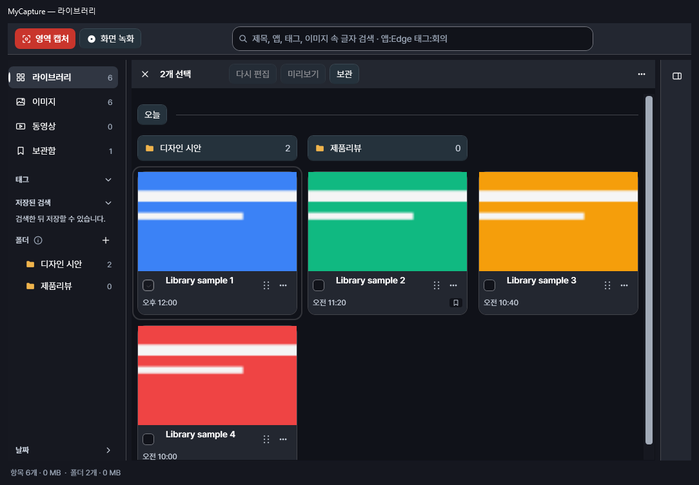
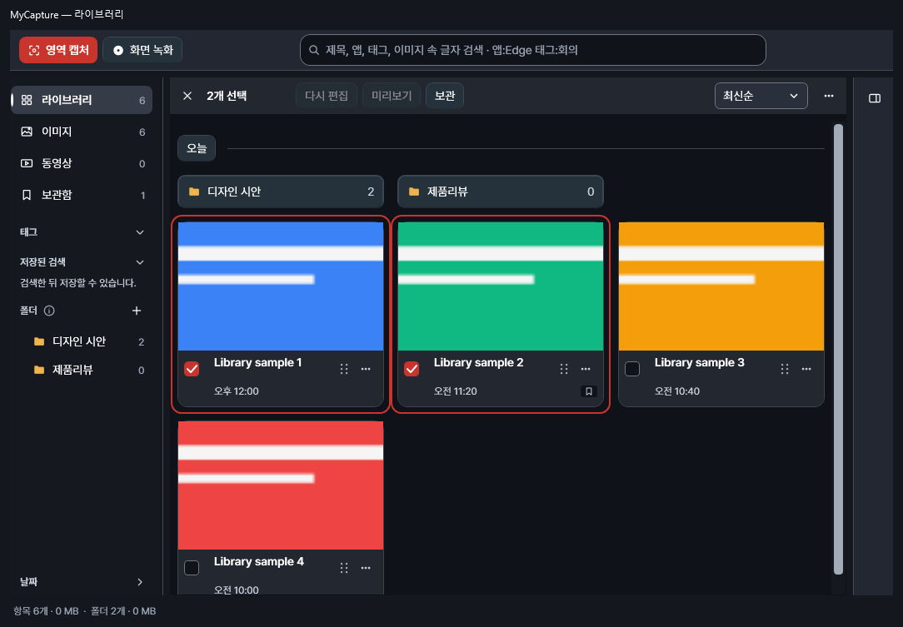
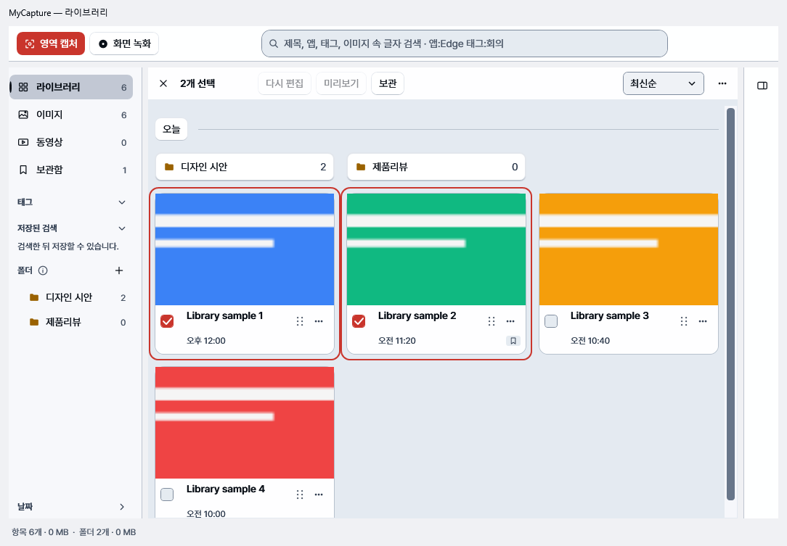
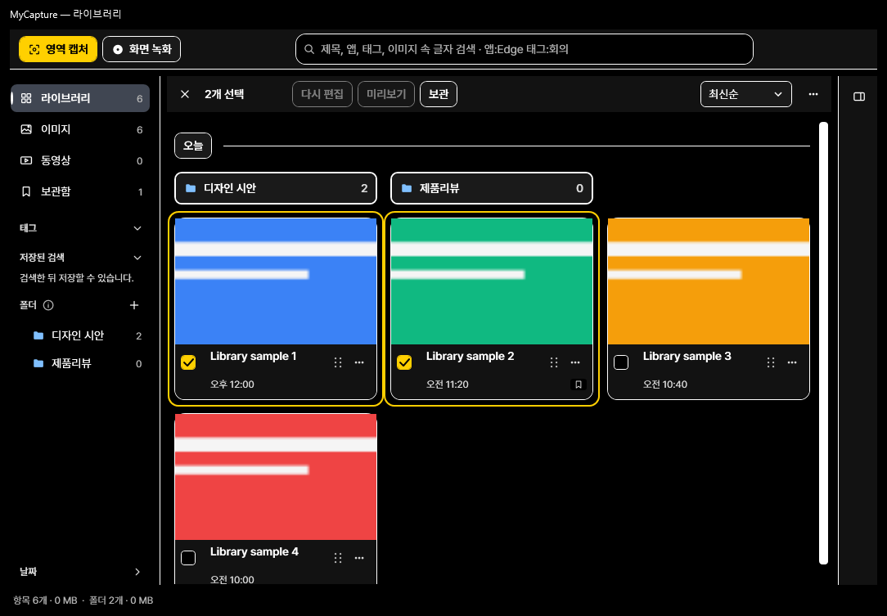
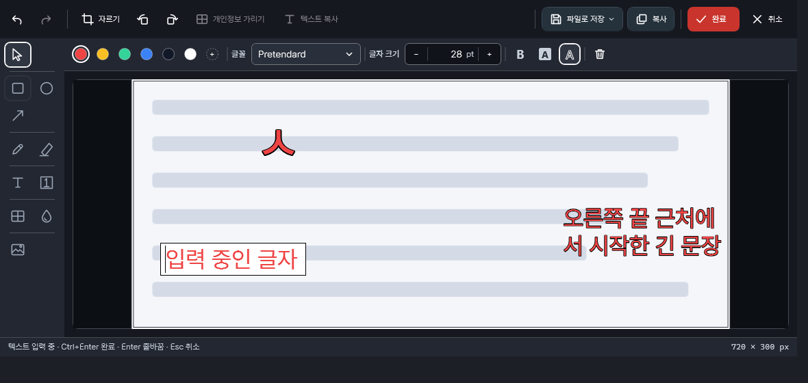
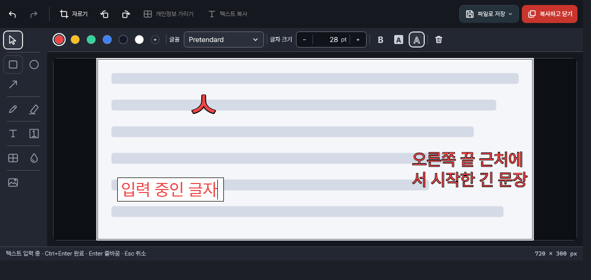
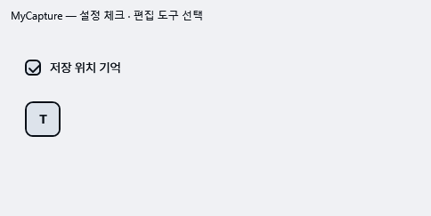
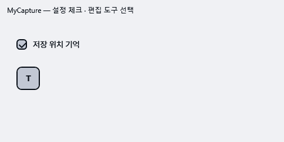
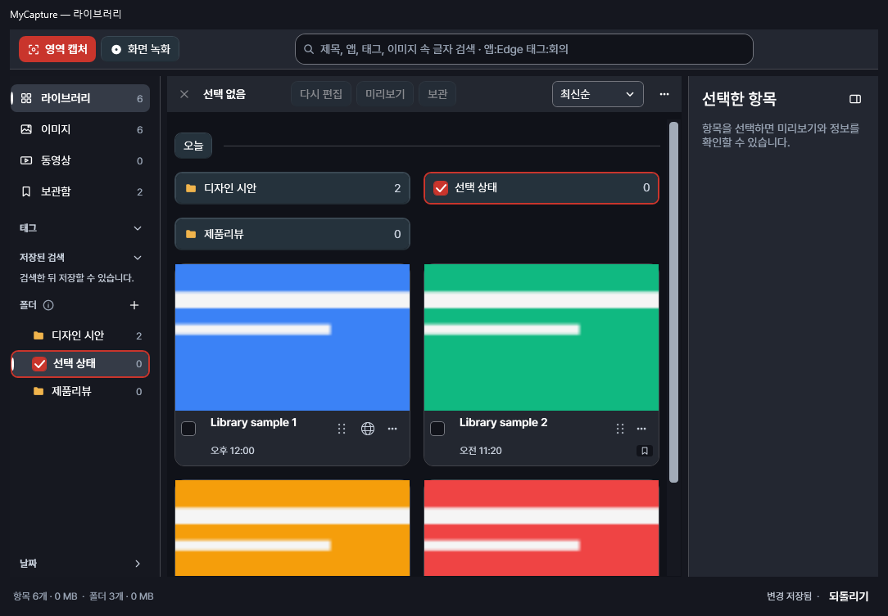
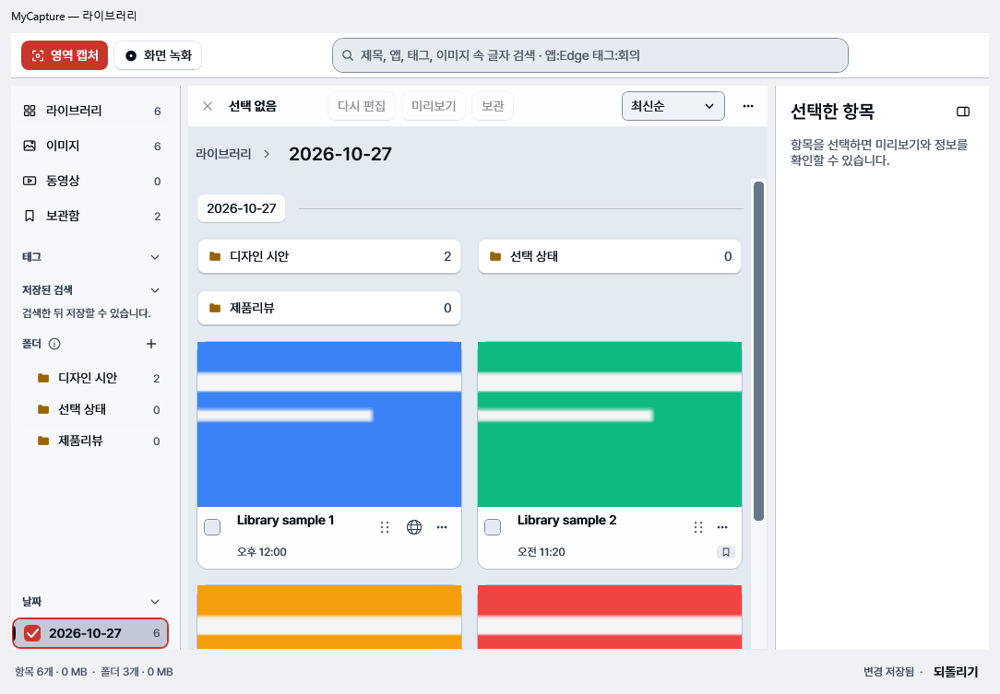

# 라이브러리·편집기 배치 검토

## 사용자 결정

- **D1**: 수락한 라이브러리 배치를 반영합니다. 폴더는 작은 스트립, 이미지의 정보·동작은 이미지 밖 푸터, 선택 동작은 안정적인 콘텐츠 머리에 놓습니다. 상세는 기본 접힘입니다.
- **D2**: 편집기는 첨부한 **파일로 저장 / 복사하고 닫기** 두 버튼만 반영합니다. 테마·도구 배치를 다시 설계하지 않습니다.
- **D3**: 입력 상태 요구는 행·열 숫자가 아니라 **입력창 안에서 잘 보이는 커서**입니다. 입력 프레임과 배경은 편집 중에만 표시하고 결과 이미지의 텍스트 배경은 보존합니다.
- **D4**: 편집 중 전역 영역 캡처를 실행해도 기존 문서를 유지하고 별도의 라이브러리 항목을 저장·복사합니다.

버전 번호 변경·릴리스·스토어 제출은 이번 변경에 포함하지 않습니다. 병합 판단은 Claude가 맡습니다.

## 검토 의견 반영

| 항목 | 반영 |
| --- | --- |
| 선택 식별 | 체크됨은 강조색 채움과 대비되는 체크, 카드는 강조색 테두리입니다. Glass/GlassLight는 빨강·흰색, 고대비는 노랑·검정의 기존 대비 쌍을 유지합니다. 두 선택 항목이 첫 줄에 실제로 존재하는지 각각 검사합니다. |
| 정렬 | 최신순 상자를 콘텐츠 머리 오른쪽에 복원했습니다. MenuItem 안 ComboBox는 없습니다. 좁은 창에서는 선택 명령을 다음 행으로 내려 정렬·⋯와 겹치지 않습니다. 선택 개수 변화는 높이에 영향을 주지 않습니다. |
| 핀 | 카드 ⋯와 선택 막대 ⋯의 첫 항목은 핀으로 띄우기입니다. P는 기존 카드 포커스 대상에 작동합니다. 단일 이미지 선택의 막대 메뉴와 실제 핀 이벤트를 검사합니다. |
| 정보 정렬 | 시간은 체크박스 뒤 제목 시작 위치에 맞춥니다. 이미지와 출처·메타데이터는 겹치지 않습니다. |
| 캡처 | `settings.Capture` → `CaptureRegion` → `HandleCaptureRequested` 경로를 사용합니다. 기본 Ctrl+Shift+C가 아닌 사용자 재설정 키도 같은 동작입니다. 새 캡처 후 기존 편집 임대·문서를 보존합니다. |
| 문구 | 추가한 한국어는 복사하고 닫기, 선택 없음, 미리보기, 미리보기 (Space)입니다. 명사형 라벨이고 해요체·느낌표는 없습니다. |

별도 편집기 내부 다시 캡처 명령은 없습니다. 기존 coordinator의 교체 API와 저장·닫기 확인은 유지합니다. 글자 캡처는 이전처럼 편집기 교체 확인 후 텍스트 선택기로 이동하며 `App.TextCapture.cs`는 변경하지 않았습니다.

출처 아이콘은 라이브러리에서 상세를 엽니다. 실제 아이콘 클릭으로 선택·상세가 연결되고 외부 창을 열지 않는지 검사합니다. 원본 열기·복사·검색은 출처 메뉴에 남아 있습니다. 출처 hover/focus 툴팁 및 카드 제목 툴팁의 독립된 동작·비가림 계약은 유지합니다.

## AS-IS / TO-BE

라이브러리 전후는 같은 fixture·한국어·1100×760 창입니다. 실제 제품 WPF 템플릿을 테스트 창에서 렌더링했으며 네이티브 제목줄은 기존 증거 도우미가 합성합니다. 설치된 Store 앱의 화면 캡처는 아닙니다. 이전 선택 화면은 선택 애니메이션 완료 대기가 없었고, 이후 화면은 두 선택 카드의 테두리가 완전히 표시된 뒤 저장합니다.

| AS-IS: 기존 구현의 선택 표시·숨은 정렬 | TO-BE: 실제 수정 구현 |
| --- | --- |
|  |  |

| 밝은 테마 | 고대비 테마 |
| --- | --- |
|  |  |

| AS-IS: 기존 편집기 | TO-BE: 두 버튼·보이는 입력 커서 |
| --- | --- |
|  |  |

수락된 라이브러리 시안은 [원본 이미지](evidence/accepted-library-proposal.png)에 보존했습니다. 시안은 기능 검증 증거가 아니며, 위 TO-BE는 실제 WPF 구현입니다.

## 테스트 단정

[검토 당시 삭제된 Assert 포함 행 111개의 개별 대응표](assertion-migration.md)에 이전 단정·새 단정 위치·사용자 결정 근거를 모두 연결했습니다. 집계는 중첩 호출 수가 아니라 diff의 행 수이며 같은 기준의 추가 행은 95개였습니다. 정렬 상태와 배치 단정은 복원했고, 남은 실제 상세 복사 버튼·열린 카드 메뉴의 피드백과 접근성을 보강했습니다.

전체 검사에서 발견한 기존 계약 두 곳도 수락 범위에 맞췄습니다. 강조색 감사는 라이브러리 선택 체크와 카드·폴더·날짜 선택 테두리의 지정 속성만 허용하며 다른 스타일·파일은 거부하는 역검사를 추가했습니다. 선택 성능 비교는 과거의 배열 투영 계산 방식을 유지하면서 기준 구현의 빈 선택 문구를 새 사양에 맞췄습니다. 체크섬 동등성과 실제 할당량 감소 단정은 유지합니다.

분리된 카드 템플릿 검사도 실제 선택 체크 스타일을 함께 불러오도록 맞췄습니다. 자르기 완료의 버튼 검사는 없어진 Ctrl+Enter 표기 버튼 대신 실제 `EditorFlowDone` 버튼을 클릭하며 `Done` 저장 의도까지 검사합니다. Done·Copy·Save 키보드 경로와 자르기 결과·Undo·Redo 단정은 유지합니다. Escape 합성 키 검사는 현재 검사 스레드의 modifier 상태만 잠시 비우고 원래 상태를 복원합니다. 실제 전역 키 입력은 발생시키지 않으며 제품의 Ctrl+Escape 차단 조건도 바꾸지 않습니다.

## 추가 선택 보완과 작은 화면

추가 승인에 따라 폴더 스트립·폴더 트리·날짜 목록에도 2 DIP 강조색 테두리와 채운 체크를 적용했습니다. 폴더와 날짜 아이콘 자리에 체크를 표시하므로 명령이나 열을 새로 늘리지 않습니다. 앱 고대비는 노랑/검정 체크, Windows 고대비는 사용자의 Highlight/HighlightText 매핑을 유지합니다.

[대비 재측정표](selection-contrast.md)는 제품 색상과 WCAG 계산 함수를 사용합니다. 선택 배경은 기존보다 강하게 조정했으며, 본문·보조·설명 글자 모두 4.5:1 이상과 기존 계층 간격을 유지했습니다. 배경 3:1과 글자 가독성이 충돌하므로 요청의 예외대로 글자를 우선하고 선택 신호는 테두리와 체크가 담당합니다.

| 설정 체크·편집 도구 AS-IS | TO-BE |
| --- | --- |
|  |  |

원격 검사에서 발견한 작은 화면의 카드 잘림은 1044 DIP 최대 창으로 로컬에서도 재현했습니다. 실제 창 폭과 논리적 콘텐츠 폭 변경을 섞은 뒤 날짜 보기로 이동하면 재활용 행의 이전 폭이 남았습니다. 행의 MaxWidth를 실제 ScrollContentPresenter 폭에 연결해 고쳤으며 가상화, 기존 열 경계 검사, 카드·명령의 화면 내부 검사는 모두 유지했습니다.

## 직접 확인 항목

- 한국어 IME가 실제 조합 중일 때 커서 위치와 깜박임을 확인합니다. 자동 검사는 커서 색·Adorner·문자 위치 사각형·출력 배경 불변을 확인합니다.
- 실제 조합 입력 후 Ctrl+Enter로 완료하고 라이브러리 및 클립보드 결과를 확인합니다. 키보드 강제 입력 opt-in 검사는 일반 전체 테스트에서 켜지 않습니다.
- 사용자 지정 영역 캡처 키로 편집 창을 포함한 영역을 촬영하고 원래 문서가 그대로 남는지 확인합니다. 자동 검사는 주입된 캡처 프레임과 같은 coordinator·저장 경로를 실행합니다.
